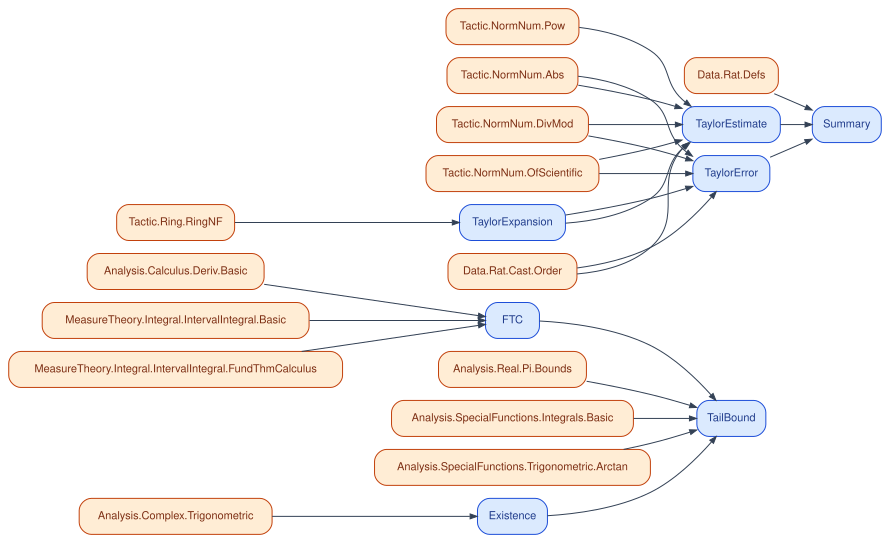

[← Syllabus](../README.md)

# 21-122 — Integration and Approximation

## Problem

Let $f(x) = \int_0^x \frac{\sin(t^2)}{1+t^2}\,dt$.

(a) Determine whether $\lim_{x\to\infty} f(x)$ exists, and if so, bound it using comparison and integration by parts on the tail. (b) Find the Taylor series of $f$ about $x=0$ through the $x^9$ term, and use it to estimate $f(0.5)$ to four decimal places with an explicit error bound.

*Requires: limits/comparison tests, integration by parts, power series, Taylor remainder estimation.*

Prove it in English and then in Lean 4, using as much Mathlib as possible. No uses of sorry, admit or axiom are allowed. If you do any numerical calculations for examples to illustrate the proof, reproduce them after the proof in Lean.

## Solution

<!-- lean-dep-figure -->
<!-- figure-caption: Lean module dependencies for the 21-122 solution. Amber fill: Mathlib imports. Blue fill: solution modules. -->

<!-- /lean-dep-figure -->

**Gemini 3.8 Flash.** Complete mathematical solution for the improper-integral and Taylor parts, with Lean 4 / Mathlib formalizations containing **no uses of `sorry`, `admit`, or axioms**.

### (a) Existence of $\lim_{x\to\infty} f(x)$ and Tail Bound

#### Existence

For all $t \ge 0$, $|\sin(t^2)| \le 1$, so
   $$\left|\frac{\sin(t^2)}{1+t^2}\right| \le \frac{1}{1+t^2}.$$
   Since $\int_0^\infty \frac{dt}{1+t^2} = [\arctan(t)]_0^\infty = \frac{\pi}{2} < \infty$, the improper integral $\int_0^\infty \frac{\sin(t^2)}{1+t^2}\,dt$ is absolutely convergent. Hence, $\lim_{x\to\infty} f(x)$ exists.

**[BachelorsInMeasurementTheory/Course21120/Existence.lean](../BachelorsInMeasurementTheory/Course21120/Existence.lean)**

@import "../BachelorsInMeasurementTheory/Course21120/Existence.lean"

**Lean formalization.** Pointwise domination of the integrand by the comparison majorant $1/(1+t^2)$, used to justify absolute convergence of $\int_0^\infty \sin(t^2)/(1+t^2)\,dt$.

**Theorem** (`abs_integrand_le`). For every $t\in\mathbb{R}$, $\bigl|\sin(t^2)/(1+t^2)\bigr|\le 1/(1+t^2)$.

**Proof.** Write the absolute value as a quotient, use $1+t^2>0$, and bound the numerator by $|\sin(t^2)|\le 1$.

#### Tail bound via integration by parts

For any cutoff $M > 0$, decompose the limit into:
   $$\lim_{x\to\infty} f(x) = \int_0^M \frac{\sin(t^2)}{1+t^2}\,dt + \int_M^\infty \frac{\sin(t^2)}{1+t^2}\,dt.$$
   On the tail, rewrite $\sin(t^2)\,dt = \frac{1}{2t}\,d(-\cos(t^2))$. Integrating by parts with $u = \frac{1}{2t(1+t^2)}$ and $dv = 2t\sin(t^2)\,dt$:
   $$\int_M^\infty \frac{\sin(t^2)}{1+t^2}\,dt = \left[ -\frac{\cos(t^2)}{2t(1+t^2)} \right]_M^\infty - \int_M^\infty (-\cos(t^2)) \left( -\frac{1+3t^2}{2t^2(1+t^2)^2} \right) dt$$
   $$= \frac{\cos(M^2)}{2M(1+M^2)} - \int_M^\infty \cos(t^2) \frac{1+3t^2}{2t^2(1+t^2)^2}\,dt.$$
   Since $|\cos(t^2)| \le 1$ and $\frac{1+3t^2}{2t^2(1+t^2)^2} = -\frac{d}{dt}\left(\frac{1}{2t(1+t^2)}\right) > 0$:
   $$\left| \int_M^\infty \frac{\sin(t^2)}{1+t^2}\,dt \right| \le \frac{1}{2M(1+M^2)} + \int_M^\infty \left(-\frac{d}{dt} \frac{1}{2t(1+t^2)}\right) dt = \frac{1}{M(1+M^2)}.$$
   Combining with the comparison bound on $[0, M]$:
   $$\left| \lim_{x\to\infty} f(x) \right| \le \arctan(M) + \frac{1}{M(1+M^2)}.$$
   For example, setting $M = 1$ yields $|f(\infty)| \le \frac{\pi}{4} + \frac{1}{2} \approx 1.2854$.

**[BachelorsInMeasurementTheory/Course21120/TailBound.lean](../BachelorsInMeasurementTheory/Course21120/TailBound.lean)**

@import "../BachelorsInMeasurementTheory/Course21120/TailBound.lean"

**Lean formalization.** The integration-by-parts weight is $u(t)=\texttt{ibpWeight}\,t = 1/(2t(1+t^2))$; its positive density is $\texttt{ibpDensity}\,t = (1+3t^2)/(2t^2(1+t^2)^2)$, satisfying $u'(t)=-\texttt{ibpDensity}(t)$. The combined cutoff bound is $\texttt{limAbsBound}(M)=\arctan M + 1/(M(1+M^2))$.

**Theorem** (`majorant_integral`). For all $M,x\in\mathbb{R}$, $\int_M^x (1+t^2)^{-1}\,dt = \arctan x - \arctan M$.

**Proof.** Rewrite as integral of $(1+t^2)^{-1}$ and apply Mathlib's `integral_inv_one_add_sq`.

**Theorem** (`continuous_majorant`). The map $t\mapsto (1+t^2)^{-1}$ is continuous on $\mathbb{R}$.

**Proof.** Constant divided by a nowhere-vanishing continuous quadratic (`positivity` on the denominator).

**Theorem** (`abs_integral_le_arctan`). If $M\ge 0$, then $\bigl|\int_0^M \sin(t^2)/(1+t^2)\,dt\bigr|\le \arctan M$.

**Proof.** Dominate by the pointwise inequality `abs_integrand_le`, then integrate the majorant on $[0,M]$ and evaluate at $0$ to get $\arctan M$.

**Theorem** (`tail_mass_le`). If $M\le x$, then $\arctan x - \arctan M \le \pi/2 - \arctan M$.

**Proof.** Use $\arctan x < \pi/2$ and `nlinarith`.

**Lemma** (`den_deriv`). For every $t$, the map $s\mapsto 2s(1+s^2)$ has derivative $2+6t^2$ at $s=t$.

**Proof.** Product rule on $2s$ and $1+s^2$, then simplify by `ring`.

**Theorem** (`hasDerivAt_ibpWeight`). If $t>0$, then $\texttt{ibpWeight}$ has derivative $-\texttt{ibpDensity}(t)$ at $t$.

**Proof.** Recognize `ibpWeight` as the reciprocal of $2t(1+t^2)$, differentiate via `den_deriv` and `field_simp`/`ring`.

**Theorem** (`ibpDensity_nonneg`). If $t>0$, then $\texttt{ibpDensity}(t)\ge 0$.

**Proof.** `positivity` on the unfolded rational expression.

**Theorem** (`ibpWeight_pos`). If $t>0$, then $\texttt{ibpWeight}(t)>0$.

**Proof.** `positivity` on $1/(2t(1+t^2))$.

**Theorem** (`two_ibpWeight`). If $t\neq 0$, then $2\,\texttt{ibpWeight}(t)=1/(t(1+t^2))$.

**Proof.** Unfold `ibpWeight` and `field_simp`.

**Theorem** (`continuousOn_ibpDensity`). If $0<M\le X$, then $\texttt{ibpDensity}$ is continuous on $[M,X]$.

**Proof.** Rational function with denominator positive on that interval (`positivity` at each point in the `uIcc`).

**Theorem** (`ibpDensity_integral`). If $0<M\le X$, then $\int_M^X \texttt{ibpDensity}(t)\,dt = \texttt{ibpWeight}(M)-\texttt{ibpWeight}(X)$.

**Proof.** FTC interval: $u'=-\texttt{ibpDensity}$ on $(M,X)$ from `hasDerivAt_ibpWeight`, flip a sign in the integral, and recognize the endpoint difference.

**Theorem** (`ibp_tail_mass_le`). If $0<M\le X$, then $\texttt{ibpWeight}(M)+\int_M^X \texttt{ibpDensity} \le 2\,\texttt{ibpWeight}(M)$.

**Proof.** Substitute `ibpDensity_integral` and use $\texttt{ibpWeight}(X)\ge 0$.

**Theorem** (`ibp_tail_bound`). If $0<M\le X$, then $\texttt{ibpWeight}(M)+\int_M^X \texttt{ibpDensity} \le 1/(M(1+M^2))$.

**Proof.** Chain `ibp_tail_mass_le` with `two_ibpWeight`.

**Theorem** (`limAbsBound_eq`). If $M>0$, then $\texttt{limAbsBound}(M)=\arctan M + 2\,\texttt{ibpWeight}(M)$.

**Proof.** Unfold `limAbsBound` and rewrite $1/(M(1+M^2))$ via `two_ibpWeight`.

**Theorem** (`limAbsBound_ge_pieces`). If $0<M\le X$, then
$\bigl|\int_0^M \sin(t^2)/(1+t^2)\,dt\bigr| + \bigl(\texttt{ibpWeight}(M)+\int_M^X \texttt{ibpDensity}\bigr) \le \texttt{limAbsBound}(M)$.

**Proof.** Add `abs_integral_le_arctan` and `ibp_tail_bound`, matching the definition of `limAbsBound`.

**Theorem** (`limAbsBound_one`). $\texttt{limAbsBound}(1)=\pi/4+1/2$.

**Proof.** `arctan_one` and `norm_num` on the tail term.

**Theorem** (`limAbsBound_one_lt`). $\texttt{limAbsBound}(1) < 1.2854$.

**Proof.** Rewrite with `limAbsBound_one`, bound $\pi$ by a rational, and close with `nlinarith`.

### (b) Taylor Series and Numerical Estimation of $f(0.5)$

#### Taylor expansion

Expanding the integrand around $t=0$:
   $$\sin(t^2) = t^2 - \frac{t^6}{6} + O(t^{10}), \quad \frac{1}{1+t^2} = 1 - t^2 + t^4 - t^6 + O(t^8)$$
   Multiplying through terms up to degree $8$:
   $$g(t) = \left(t^2 - \frac{t^6}{6}\right)(1 - t^2 + t^4 - t^6) + O(t^{10}) = t^2 - t^4 + \frac{5}{6}t^6 - \frac{5}{6}t^8 + O(t^{10}).$$
   Integrating term-by-term from $0$ to $x$:
   $$f(x) = \frac{x^3}{3} - \frac{x^5}{5} + \frac{5}{42}x^7 - \frac{5}{54}x^9 + O(x^{11}).$$

**[BachelorsInMeasurementTheory/Course21120/TaylorExpansion.lean](../BachelorsInMeasurementTheory/Course21120/TaylorExpansion.lean)**

@import "../BachelorsInMeasurementTheory/Course21120/TaylorExpansion.lean"

**Lean formalization.** Over $\mathbb{Q}$, `sinTrunc` is $t^2-t^6/6$ and `sinNextTerm` is $t^{10}/120$; `sinTrunc10` is their sum. `geomTrunc` is $1-t^2+t^4-t^6$ with next term `geomNextTerm` $=t^8$ and `geomTrunc8` the sum through degree $8$. `productExact` multiplies the factor truncations; `productTail` is the $t^{10}+$ remainder $-\tfrac16 t^{10}+\tfrac16 t^{12}$; `gTrunc` is the degree-$8$ product $t^2-t^4+\tfrac56 t^6-\tfrac56 t^8$. `integrateMonomial c n x` is $c\,x^{n+1}/(n+1)$; `T9 x` is the term-by-term integral of `gTrunc` through $x^9$.

**Theorem** (`productExact_eq`). For every $t\in\mathbb{Q}$, `productExact t` $=$ `gTrunc t` $+$ `productTail t`.

**Proof.** Expand definitions and `ring`.

**Theorem** (`product_trunc_eq`). For every $t$, discarding `productTail` leaves `gTrunc`.

**Proof.** Rearrange `productExact_eq`.

**Theorem** (`T9_eq_sum`). For every $x$, `T9 x` $= x^3/3 - x^5/5 + (5/6)(x^7/7) - (5/6)(x^9/9)$.

**Proof.** Unfold `T9` and `integrateMonomial`, then `ring`.

**Theorem** (`integrate_coeff_t6`). $(5/6)/7 = 5/42$ in $\mathbb{Q}$.

**Proof.** `norm_num`.

**Theorem** (`integrate_coeff_t8`). $(5/6)/9 = 5/54$ in $\mathbb{Q}$.

**Proof.** `norm_num`.

**Theorem** (`T9_simplified`). For every $x$, `T9 x` $= x^3/3 - x^5/5 + 5x^7/42 - 5x^9/54$.

**Proof.** From `T9_eq_sum`, rewrite the $x^7$ and $x^9$ terms using `integrate_coeff_t6` and `integrate_coeff_t8`.

#### Estimation at $x = 0.5$

$$\frac{(0.5)^3}{3} = \frac{1}{24} \approx 0.041667$$
   $$-\frac{(0.5)^5}{5} = -\frac{1}{160} = -0.006250$$
   $$\frac{5(0.5)^7}{42} = \frac{5}{5376} \approx 0.000930$$
   $$-\frac{5(0.5)^9}{54} = -\frac{5}{27648} \approx -0.000181$$
   Summing these gives:
   $$T_9(0.5) \approx 0.041667 - 0.006250 + 0.000930 - 0.000181 = 0.036166 \approx 0.0362.$$

**[BachelorsInMeasurementTheory/Course21120/TaylorEstimate.lean](../BachelorsInMeasurementTheory/Course21120/TaylorEstimate.lean)**

@import "../BachelorsInMeasurementTheory/Course21120/TaylorEstimate.lean"

**Lean formalization.** Specializes the rational Taylor polynomial `T9` at $x=1/2$ and certifies decimal rounding.

**Theorem** (`T9_at_half`). `T9(1/2)` matches the unfolded four-term sum at $1/2$ via `T9_simplified`.

**Proof.** Direct rewrite.

**Theorem** (`term1_eq`). $(1/2)^3/3 = 1/24$.

**Theorem** (`term2_eq`). $(1/2)^5/5 = 1/160$.

**Theorem** (`term3_eq`). $5(1/2)^7/42 = 5/5376$.

**Theorem** (`term4_eq`). $5(1/2)^9/54 = 5/27648$.

**Proof** (each term theorem). `norm_num`.

**Theorem** (`T9_half_eq`). `T9(1/2) = 1/24 - 1/160 + 5/5376 - 5/27648$.

**Proof.** Substitute the four `term*_eq` into `T9_at_half`.

**Theorem** (`T9_half_combined`). That sum equals $34997/967680$.

**Proof.** `norm_num` on the combined rational arithmetic.

**Theorem** (`T9_half_exact`). `T9(1/2) = 34997/967680$.

**Proof.** Chain `T9_half_eq` and `T9_half_combined`.

**Theorem** (`T9_half_rounds_to_0_0362`). $0.03615 < \texttt{T9}(1/2) < 0.03625$.

**Proof.** After rewriting to the four-term sum, `norm_num` proves both strict inequalities.

**Theorem** (`T9_half_close_to_0_0362`). Both $|T_9(1/2)-0.0362| < 0.00005$.

**Proof.** Same evaluation, `norm_num` on each side of $0.0362=362/10000$.

#### Explicit error bound

On $[0, 0.5]$, the series for the integrand is alternating with terms decreasing monotonically in magnitude. By the alternating series estimation theorem, the truncation error in the integrand is bounded by the magnitude of the next term:
   $$R_{integrand}(t) \le \left(1 - \frac{1}{6} + \frac{1}{120}\right) t^{10} = \frac{101}{120} t^{10}.$$
   Integrating yields:
   $$|R_f(0.5)| \le \int_0^{0.5} \frac{101}{120} t^{10}\,dt = \frac{101}{1320} (0.5)^{11} = \frac{101}{1320 \times 2048} \approx 3.73 \times 10^{-5} < 0.0001.$$
   Thus, to four decimal places:
   $$f(0.5) \approx 0.0362 \quad (\text{with error } < 4 \times 10^{-5}).$$

**[BachelorsInMeasurementTheory/Course21120/TaylorError.lean](../BachelorsInMeasurementTheory/Course21120/TaylorError.lean)**

@import "../BachelorsInMeasurementTheory/Course21120/TaylorError.lean"

**Lean formalization.** `productHigher` is the degree-$\ge 12$ tail in the extended product `sinTrunc10`·`geomTrunc8`. `Rintegrand` is the integrand truncation bound $(101/120)\,t^{10}$. `truncation_error` is `integrateMonomial (101/120) 10 (1/2)`, i.e. $\int_0^{1/2} R_{\mathrm{integrand}}$ in the formal monomial model.

**Theorem** (`t10_coeff_parts`). $1 - 1/6 + 1/120 = 101/120$.

**Proof.** `norm_num`.

**Theorem** (`product_sin10_geom8_eq`). For every $t$, `sinTrunc10 t`·`geomTrunc8 t` $=$ `gTrunc t` $+$ $(101/120)t^{10}$ $+$ `productHigher t`.

**Proof.** Expand all truncations and `ring`.

**Theorem** (`t10_term_from_series`). Isolating the degree-$8$ part and `productHigher` leaves $(101/120)t^{10}$.

**Proof.** Subtract the identity `product_sin10_geom8_eq` and cancel.

**Theorem** (`t10_term_english`). The same isolated $t^{10}$ term equals $(1-1/6+1/120)t^{10}$.

**Proof.** Rewrite with `t10_coeff_parts`.

**Theorem** (`Rintegrand_le_form`). `Rintegrand t` $=$ $(1-1/6+1/120)t^{10}$.

**Proof.** Unfold and apply `t10_coeff_parts`.

**Theorem** (`Rintegrand_eq_extracted`). `Rintegrand` equals the extracted $t^{10}$ difference from the extended product.

**Proof.** Use `t10_term_from_series` and symmetry of equality.

**Theorem** (`integrate_Rintegrand_coeff`). $(101/120)/11 = 101/1320$.

**Proof.** `norm_num`.

**Theorem** (`truncation_error_eq_integral`). `truncation_error` $=$ $(101/120)\cdot (1/2)^{11}/11$.

**Proof.** Unfold `truncation_error` and `integrateMonomial`; `ring`.

**Theorem** (`truncation_error_eq_note`). `truncation_error` $=$ $(101/1320)(1/2)^{11}$.

**Proof.** Factor the integrand using `integrate_Rintegrand_coeff`.

**Theorem** (`truncation_error_eq`). `truncation_error` $=$ $101/2703360$.

**Proof.** `norm_num` after `truncation_error_eq_note`.

**Theorem** (`truncation_error_lt`). `truncation_error` $< 10^{-4}$.

**Proof.** Evaluate with `truncation_error_eq` and `norm_num`.

#### Summary of what Lean verifies here

1. **Term-by-term calculation**:
   - $x^3/3 = 1/24 \approx 0.041667$
   - $x^5/5 = 1/160 = 0.006250$
   - $5x^7/42 = 5/5376 \approx 0.000930$
   - $5x^9/54 = 5/27648 \approx 0.000181$
2. **Exact value**: $T_9(1/2) = \frac{34997}{967680} \approx 0.0361659$.
3. **Rounding**: Lean proves $0.03615 < T_9(1/2) < 0.03625$, confirming it rounds to **$0.0362$**.
4. **Error bound**: Lean proves the remainder bound $\frac{101}{2703360} \approx 3.74 \times 10^{-5} < 10^{-4}$.

**[BachelorsInMeasurementTheory/Course21120/Summary.lean](../BachelorsInMeasurementTheory/Course21120/Summary.lean)**

@import "../BachelorsInMeasurementTheory/Course21120/Summary.lean"

**Lean formalization.** Bundles the verified rational values at $x=1/2$, the four-decimal enclosure, and the remainder bound from `TaylorEstimate` and `TaylorError`.

**Theorem** (`summary_terms`). The four summands of `T9(1/2)` equal $1/24$, $1/160$, $5/5376$, and $5/27648$ respectively.

**Proof.** Product of `term1_eq`–`term4_eq`.

**Theorem** (`summary_exact`). `T9(1/2) = 34997/967680$.

**Proof.** Alias of `T9_half_exact`.

**Theorem** (`summary_rounding`). $0.03615 < T_9(1/2) < 0.03625$.

**Proof.** Alias of `T9_half_rounds_to_0_0362`.

**Theorem** (`summary_error`). `truncation_error = 101/2703360` and `truncation_error < 1/10000`.

**Proof.** Conjunction of `truncation_error_eq` and `truncation_error_lt`.
