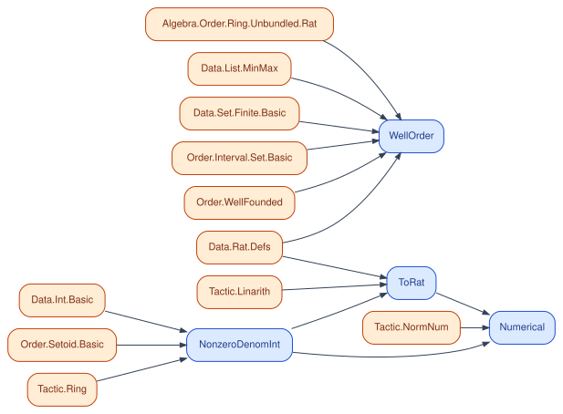

[← Syllabus](../README.md)

# 21-127 — Concepts of Mathematics

## Problem

Define a relation $\sim$ on $\mathbb{Z} \times (\mathbb{Z}\setminus\{0\})$ by $(a,b)\sim(c,d) \iff ad = bc$.

(a) Prove $\sim$ is an equivalence relation. 

(b) Prove the induced quotient set is in bijection with $\mathbb{Q}$, exhibiting the bijection explicitly and proving it well-defined, injective, and surjective. 

(c) Prove by strong induction that every nonempty subset of $\mathbb{Q}_{\geq 0}$ that is well-ordered under the usual order is either empty or has infinitely many elements — or find the flaw in that claim and prove the correct statement instead, using contradiction.

*Requires: relations/equivalence classes, functions/bijections, induction, proof by contradiction, and — the real test — recognizing a false claim rather than forcing a proof of it.*

## Solution

<!-- lean-dep-figure -->
<!-- figure-caption: Lean module dependencies for the 21-127 solution. Amber fill: Mathlib imports. Blue fill: solution modules. -->

<!-- /lean-dep-figure -->

**Gemini 3.8 Flash.** Here is the complete solution and formalization in Lean 4 with Mathlib.

### (a) Equivalence Relation

We define $S = \mathbb{Z} \times (\mathbb{Z} \setminus \{0\})$ and $(a,b) \sim (c,d) \iff ad = bc$.

- **Reflexivity.** $ab = ba$ holds by commutativity of multiplication in $\mathbb{Z}$.
- **Symmetry.** $ad = bc$ implies $cb = da$, so $(c,d) \sim (a,b)$.
- **Transitivity.** If $ad = bc$ and $cf = de$, multiplying through yields $$(af)d = (ad)f = (bc)f = b(cf) = b(de) = (be)d.$$ Since $d \ne 0$ and $\mathbb{Z}$ is an integral domain (has no zero divisors), $(af - be)d = 0$ implies $af = be$.

**[BachelorsInMeasurementTheory/Course21127/NonzeroDenomInt.lean](../BachelorsInMeasurementTheory/Course21127/NonzeroDenomInt.lean)**

@import "../BachelorsInMeasurementTheory/Course21127/NonzeroDenomInt.lean"

**Lean formalization.** The structure `NonzeroDenomInt` packages an integer numerator, a nonzero integer denominator, and the proof that the denominator is nonzero. The relation `Rel` on pairs holds when $ad=bc$ in the cross-multiplication sense ($x.\mathrm{num}\cdot y.\mathrm{den}=x.\mathrm{den}\cdot y.\mathrm{num}$). The instance `nonzeroDenomIntSetoid` registers `Rel` as Mathlib's equivalence relation on this type.

**Lemma** (`rel_refl`). For every pair $x$, $x\sim x$ under `Rel`.

**Proof.** Expand `Rel` and close with `ring`.

**Lemma** (`rel_symm`). If $x\sim y$, then $y\sim x$.

**Proof.** From $x.\mathrm{num}\cdot y.\mathrm{den}=x.\mathrm{den}\cdot y.\mathrm{num}$, commute factors and apply symmetry of equality.

**Lemma** (`rel_trans`). If $x\sim y$ and $y\sim z$, then $x\sim z$.

**Proof.** Multiply the two cross-product identities, rearrange with `ring`, factor $(x.\mathrm{num}\cdot z.\mathrm{den}-x.\mathrm{den}\cdot z.\mathrm{num})$ against the nonzero $y.\mathrm{den}$; either the difference vanishes or $y.\mathrm{den}=0$, contradicting $y.\mathrm{den\_ne\_zero}$.

### (b) Bijection with $\mathbb{Q}$

The canonical map is $F(a, b) = \frac{a}{b} \in \mathbb{Q}$.

- **Well-defined.** If $ad = bc$, then $\frac{a}{b} = \frac{c}{d}$ in $\mathbb{Q}$ because clearing denominators yields $ad - bc = 0$.
- **Injective.** If $\frac{a}{b} = \frac{c}{d}$ in $\mathbb{Q}$, then $ad = bc$ in $\mathbb{Z}$, meaning $[(a,b)] = [(c,d)]$.
- **Surjective.** Every $q \in \mathbb{Q}$ has canonical numerator $q.\text{num} \in \mathbb{Z}$ and denominator $q.\text{den} \in \mathbb{N}^+$, with $q = \frac{q.\text{num}}{q.\text{den}}$. Since $q.\text{den} \ne 0$, $F([(q.\text{num}, q.\text{den})]) = q$.

**[BachelorsInMeasurementTheory/Course21127/ToRat.lean](../BachelorsInMeasurementTheory/Course21127/ToRat.lean)**

@import "../BachelorsInMeasurementTheory/Course21127/ToRat.lean"

**Lean formalization.** The map `toRat` sends a pair to the rational $\mathrm{num}/\mathrm{den}$ after casting to $\mathbb{Q}$. The map `toRatQuot` is the induced function on the quotient by `nonzeroDenomIntSetoid`. The equiv `quotientEquivRat` packages bijectivity of `toRatQuot`.

**Lemma** (`rat_div_eq_of_mul_eq`). For rationals $a,b,c,d$ with $b,d\ne 0$, if $ad=bc$ then $a/b=c/d$.

**Proof.** Rewrite with `div_eq_div_iff` and discharge the cross-multiplication with `linarith`.

**Lemma** (`rat_mul_eq_of_div_eq`). For $b,d\ne 0$, if $a/b=c/d$ then $ad=bc$.

**Proof.** Apply the forward direction of `div_eq_div_iff`, then `linarith`.

**Lemma** (`toRat_wellDefined`). If $x\sim y$, then `toRat x = toRat y`.

**Proof.** Cast the integer cross-product to $\mathbb{Q}$ and invoke `rat_div_eq_of_mul_eq` using nonzero denominators.

**Theorem** (`toRatQuot_injective`). The quotient map `toRatQuot` is injective.

**Proof.** By `Quotient.inductionOn₂`, equal values in $\mathbb{Q}$ force equal fractions; backward direction of fraction equality yields `Rel`, hence `Quotient.sound`.

**Theorem** (`toRatQuot_surjective`). `toRatQuot` is surjective.

**Proof.** Given $q\in\mathbb{Q}$, represent it by $\langle q.\mathrm{num}, q.\mathrm{den}\rangle$ with nonzero denominator and verify `toRat` returns $q$ via `Rat.num_div_den`.

**Theorem** (`toRatQuot_bijective`). `toRatQuot` is bijective.

**Proof.** Pair `toRatQuot_injective` with `toRatQuot_surjective`.

### (c) The Flaw in the Claim and the Correct Statement

The prompt poses the challenge:
> *"Prove by strong induction that every nonempty subset of $\mathbb{Q}_{\geq 0}$ that is well-ordered under the usual order is either empty or has infinitely many elements — or find the flaw in that claim and prove the correct statement instead, using contradiction."*

**The Flaws in the Claim:**
1. **Syntactic contradiction:** A subset assumed to be *nonempty* cannot be *empty*.
2. **Mathematical falsehood:** The claim asserts that any nonempty well-ordered subset of $\mathbb{Q}_{\ge 0}$ must be infinite. This is completely false. Any finite nonempty subset of $\mathbb{Q}_{\ge 0}$ (for instance, the singleton $\{0\}$, or $\{0, 1\}$, or $\{1/2\}$) is:
   - A subset of $\mathbb{Q}_{\ge 0}$,
   - Nonempty,
   - Well-ordered under the standard $\le$ order (every nonempty subset has a least element),
   - Yet strictly **finite**, not infinite.
3. **Why strong induction fails here (the trap):** An attempted proof by induction would try to construct an infinite sequence $x_0 < x_1 < x_2 < \dots$ by repeatedly taking successors. This fails because a finite well-ordered subset has a **maximal element** with no strictly greater element in the set.

**The Correct Theorems:**
1. **Refutation by contradiction:** The claim is false. Assuming the claim holds for $S = \{0\}$ implies $\{0\} = \emptyset$ or $\{0\}$ is infinite, both of which immediately contradict the properties of singletons.
2. **Positive statement via induction:** Every finite nonempty subset of $\mathbb{Q}$ (and hence of $\mathbb{Q}_{\ge 0}$) has a least element, and is therefore well-ordered. We formalize this by induction on lists.

**[BachelorsInMeasurementTheory/Course21127/WellOrder.lean](../BachelorsInMeasurementTheory/Course21127/WellOrder.lean)**

@import "../BachelorsInMeasurementTheory/Course21127/WellOrder.lean"

**Lean formalization.** The class `IsWellOrderedSet` axiomatizes that every nonempty subset $T\subseteq S$ has a least element in $T$. The proposition `FalseClaim` formalizes the prompt's flawed statement: every nonempty well-ordered $S\subseteq\mathbb{Q}_{\ge 0}$ must be empty or infinite.

**Lemma** (`singleton_zero_well_ordered`). The singleton $\{0\}\subseteq\mathbb{Q}$ is well-ordered.

**Proof.** Any nonempty $T\subseteq\{0\}$ forces $T=\{0\}$; $0$ is the least element.

**Lemma** (`singleton_zero_nonneg`). $\{0\}\subseteq\mathbb{Q}_{\ge 0}$.

**Proof.** Membership in `Set.Ici 0` from reflexivity of $\le$.

**Lemma** (`singleton_zero_nonempty`). The set $\{0\}$ is nonempty.

**Proof.** Witness $0$.

**Theorem** (`false_claim_is_false`). The proposition `FalseClaim` is false.

**Proof.** If the claim held, `{0}` would be empty or infinite; emptiness contradicts $0\in\{0\}$, and infinitude contradicts finiteness of a singleton.

**Lemma** (`list_has_min`). For any rational $a$ and list $l$, the extended list $a::l$ has a least element among its members.

**Proof.** Use Mathlib's `List.minimum_of_length_pos` on the positive-length list.

**[BachelorsInMeasurementTheory/Course21127/Numerical.lean](../BachelorsInMeasurementTheory/Course21127/Numerical.lean)**

@import "../BachelorsInMeasurementTheory/Course21127/Numerical.lean"

**Lean formalization.** The pairs `pair1` $=\langle 1,2\rangle$ and `pair2` $=\langle 2,4\rangle$ illustrate the relation and map to rationals. Mathlib `example` checks verify: `Rel pair1 pair2` (since $1\cdot 4=2\cdot 2$), `toRat pair1 = 1/2`, `toRat pair2 = 1/2`, and $\min(1/2,1/3)=1/3$.
