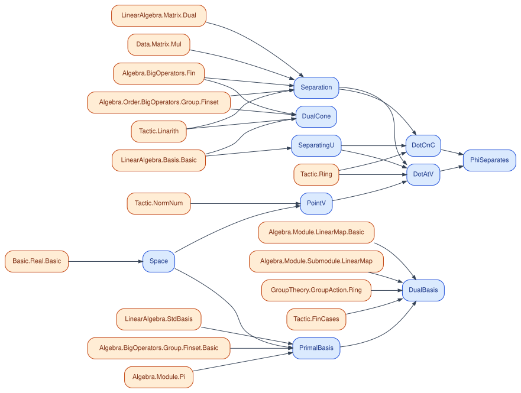

[← Syllabus](../README.md)

# 21-241 — Matrices and Linear Transformations

## Problem

Let $V$ be a finite-dimensional real vector space, $C \subset V$ a convex cone with nonempty interior, and $v \notin C$.

(a) Construct a basis of $V$ and its dual basis of $V^*$ explicitly for the case $V = \mathbb{R}^3$, $C = \{x : x_1, x_2, x_3 \geq 0\}$. (b) Prove that a linear functional $\varphi \in V^*$ separating $v$ from $C$ (i.e., $\varphi(v) < 0 \leq \varphi(c)$ for all $c \in C$) corresponds to a specific vector under the standard inner product, and compute it for a concrete $v \notin C$. (c) Prove that the set of linear functionals nonnegative on all of $C$ is itself a convex cone in $V^*$, and identify its dual basis representation.

*Requires: basis/dual basis construction, linear transformations, the vector-space language Scott's Theorem 1.1 is stated in — not just matrix computation.*

Prove it in English and then in Lean 4, using as much Mathlib as possible.  No uses of sorry, admit or axiom are allowed.  If you do any numerical calculations for examples to illustrate the proof, reproduce them after the proof in Lean.

## Solution

<!-- lean-dep-figure -->
<!-- figure-caption: Lean module dependencies for the 21-241 solution. Amber fill: Mathlib imports. Blue fill: solution modules. -->

<!-- /lean-dep-figure -->

**Gemini 3.8 Flash**
**Geometric Separation and Scott's Theorem 1.1.**

Let $V$ be a finite-dimensional real vector space. A non-empty subset $C \subseteq V$ is a **convex cone** if:
1. For all $x, y \in C$, $x + y \in C$ (closed under addition).
2. For all $x \in C$ and all $\lambda \ge 0$, $\lambda x \in C$ (closed under non-negative scaling).

Scott's Theorem 1.1 (the geometric Hahn–Banach separation theorem for convex cones) establishes that if $C \subset V$ is a convex cone with non-empty interior $\operatorname{int}(C) \neq \emptyset$, and $v \in V \setminus C$, then there exists a non-zero linear functional $\varphi \in V^*$ strictly separating $v$ from $\operatorname{int}(C)$ and non-strictly separating $v$ from $C$:
$$\varphi(v) < 0 \le \varphi(c), \quad \forall c \in C.$$
The separation level must be $0$: if $\varphi(c) \ge \alpha$ for all $c \in C$, then for any $\lambda > 0$, $\varphi(\lambda c) = \lambda \varphi(c) \ge \alpha \implies \varphi(c) \ge \alpha/\lambda$. Sending $\lambda \to \infty$ forces $\varphi(c) \ge 0$. Furthermore, since $0 \in \overline{C}$, $\alpha \le \varphi(0) = 0$.

### (a) Basis and Dual Basis Construction

Let $V = \mathbb{R}^3$ and $C = \{x = (x_0, x_1, x_2) \in \mathbb{R}^3 \mid x_0 \ge 0, x_1 \ge 0, x_2 \ge 0\}$ be the non-negative orthant.

**[BachelorsInMeasurementTheory/Course21241/Space.lean](../BachelorsInMeasurementTheory/Course21241/Space.lean)**

@import "../BachelorsInMeasurementTheory/Course21241/Space.lean"

**Lean formalization.** The type abbreviation `V` is $\mathbb{R}^3$ as functions `Fin 3 → ℝ`. The set `C` is the nonnegative orthant $\{x\mid \forall i,\,0\le x_i\}$.

#### Primal basis of $V$

Define the standard basis vectors $e_0, e_1, e_2 \in V$ by:
$$e_i(j) = \delta_{ij} = \begin{cases} 1 & \text{if } i = j, \\ 0 & \text{if } i \neq j. \end{cases}$$
Explicitly:
$$e_0 = (1, 0, 0), \quad e_1 = (0, 1, 0), \quad e_2 = (0, 0, 1).$$
- **Spanning:** Any vector $x \in V$ can be uniquely expressed as: $$x = \sum_{i=0}^2 x_i e_i.$$
- **Linear Independence:** If $\sum_{i=0}^2 c_i e_i = 0$, evaluating the $j$-th coordinate gives $c_j = 0$ for each $j \in \{0, 1, 2\}$.

**[BachelorsInMeasurementTheory/Course21241/PrimalBasis.lean](../BachelorsInMeasurementTheory/Course21241/PrimalBasis.lean)**

@import "../BachelorsInMeasurementTheory/Course21241/PrimalBasis.lean"

**Lean formalization.** For each $i\in\{0,1,2\}$, `e i` is the standard basis vector (`Pi.single i 1`).

**Theorem** (`vector_eq_sum`). Every $x\in V$ equals $\sum_{i=0}^2 x_i\cdot e_i$.

**Proof.** Coordinatewise: `simp` with `Pi.single_apply` and `Finset.sum_ite_eq`.

**Theorem** (`e_linearIndependent`). The family `e` is $\mathbb{R}$-linearly independent.

**Proof.** Mathlib's `Pi.linearIndependent_single_one` for `Fin 3`.

#### Dual basis of $V^*$

The algebraic dual space is $V^* = \operatorname{Hom}_\mathbb{R}(V, \mathbb{R})$. The dual basis $\{e_0^*, e_1^*, e_2^*\} \subset V^*$ is defined by the coordinate projections:
$$e_i^*(x) := x_i = \operatorname{proj}_i(x).$$
- **Duality relation:** $$e_i^*(e_j) = e_j(i) = \delta_{ij}.$$
- **Expansion in the dual basis:** For any linear map $\varphi \in V^*$, by linearity: $$\varphi(x) = \varphi\left(\sum_{i=0}^2 x_i e_i\right) = \sum_{i=0}^2 x_i \varphi(e_i) = \sum_{i=0}^2 \varphi(e_i) e_i^*(x),$$ meaning $\varphi = \sum_{i=0}^2 \varphi(e_i) e_i^*$.

**[BachelorsInMeasurementTheory/Course21241/DualBasis.lean](../BachelorsInMeasurementTheory/Course21241/DualBasis.lean)**

@import "../BachelorsInMeasurementTheory/Course21241/DualBasis.lean"

**Lean formalization.** For each $i$, the linear functional `e_star i` is coordinate projection $x\mapsto x_i$.

**Theorem** (`e_star_apply_e`). $e_i^*(e_j)=\delta_{ij}$.

**Proof.** Case split on `Fin 3` indices with `fin_cases`.

**Theorem** (`dual_eq_sum`). Every $\varphi\in V^*$ satisfies $\varphi=\sum_i \varphi(e_i)\cdot e_i^*$.

**Proof.** Extend by linearity: expand $x$ in the primal basis, push $\varphi$ through the finite sum, and simplify uses of `e_star`.

---

### (b) Inner Product Representation and Concrete Separation

1. **Riesz Isomorphism under the Standard Inner Product:** Equip $V$ with the standard Euclidean inner product: $$\langle u, x \rangle = \sum_{i=0}^2 u_i x_i.$$ Every vector $u \in V$ induces a linear functional $\varphi_u(x) = \langle u, x \rangle$. Conversely, every linear functional $\varphi \in V^*$ uniquely corresponds to the vector: $$u_\varphi := \sum_{i=0}^2 \varphi(e_i) e_i = (\varphi(e_0), \varphi(e_1), \varphi(e_2)).$$ Indeed: $$\langle u_\varphi, x \rangle = \sum_{i=0}^2 \varphi(e_i) x_i = \varphi\left(\sum_{i=0}^2 x_i e_i\right) = \varphi(x).$$

2. **Non-negativity on $C$:** $$\forall c \in C,\ \langle u, c \rangle \ge 0 \iff \forall i \in \{0, 1, 2\},\ u_i \ge 0.$$
   - $(\implies)$ Since $e_i \in C$, we have $u_i = \langle u, e_i \rangle \ge 0$.
   - $(\impliedby)$ If $u_i \ge 0$ for all $i$ and $c \in C$ (so $c_i \ge 0$), then $\langle u, c \rangle = \sum_{i=0}^2 u_i c_i \ge 0$.

3. **Separating Vector for $v \notin C$:** If $v \notin C$, then by definition $\exists k \in \{0, 1, 2\}$ such that $v_k < 0$. Choosing $u = e_k$, we verify:
   - For all $c \in C$: $\langle u, c \rangle = \langle e_k, c \rangle = c_k \ge 0$.
   - At $v$: $\langle u, v \rangle = \langle e_k, v \rangle = v_k < 0$. Thus $\varphi(x) = \langle e_k, x \rangle = e_k^*(x)$ is the desired separating functional.

**[BachelorsInMeasurementTheory/Course21241/Separation.lean](../BachelorsInMeasurementTheory/Course21241/Separation.lean)**

@import "../BachelorsInMeasurementTheory/Course21241/Separation.lean"

**Lean formalization.** `dot` is the standard dot product on `V`. `toDual` / `toVec` are the Riesz isomorphism and its inverse via Mathlib's `dotProductEquiv` on `Fin 3`.

**Lemma** (`dot_comm`). $\langle u,v\rangle=\langle v,u\rangle$.

**Proof.** `dotProduct_comm`.

**Lemma** (`dot_e`). $\langle u,e_i\rangle=u_i$.

**Proof.** Simplify dot product against a single-coordinate vector.

**Theorem** (`toDual_toVec`). `toDual (toVec φ) = φ`.

**Proof.** Left inverse of the equivalence.

**Theorem** (`toVec_toDual`). `toVec (toDual u) = u`.

**Proof.** Right inverse of the equivalence.

**Theorem** (`nonneg_on_C_iff`). $\forall c\in C,\,\langle u,c\rangle\ge 0$ iff each coordinate $u_i\ge 0$.

**Proof.** Forward: test on $e_i\in C$. Backward: nonnegative sum of products of nonnegative coordinates.

**Theorem** (`exists_separating_vector`). If $v\notin C$, there exists $u$ with $\langle u,c\rangle\ge 0$ for all $c\in C$ and $\langle u,v\rangle<0$.

**Proof.** Failure of nonnegativity of coordinates yields some $i$ with $v_i<0$; take $u=e_i$.

4. **Concrete Numerical Example:** Let $v = (-1, 1, 1)$.
   - $v \notin C$ because $v_0 = -1 < 0$.
   - Choose $u = e_0 = (1, 0, 0)$.
   - Separation check:
     $$\langle u, v \rangle = 1 \cdot (-1) + 0 \cdot 1 + 0 \cdot 1 = -1 < 0.$$
   - Cone non-negativity: for any $c = (c_0, c_1, c_2) \in C$,
     $$\langle u, c \rangle = c_0 \ge 0.$$

---

#### Choice of point $v$ not in $C$

**[BachelorsInMeasurementTheory/Course21241/PointV.lean](../BachelorsInMeasurementTheory/Course21241/PointV.lean)**

@import "../BachelorsInMeasurementTheory/Course21241/PointV.lean"

**Lean formalization.** The vector `v` has coordinates $(-1,1,1)$.

**Lemma** (`v_zero`, `v_one`, `v_two`). $v_0=-1$, $v_1=v_2=1$.

**Proof.** Definitional (`rfl`).

**Theorem** (`v_coords`). $v_0=-1\land v_1=1\land v_2=1$.

**Proof.** Combine the coordinate lemmas.

**Theorem** (`v_zero_neg`). $v_0<0$.

**Proof.** `norm_num` after `v_zero`.

**Theorem** (`v_not_mem_C`). $v\notin C$.

**Proof.** If $v\in C$ then $0\le v_0=-1$, contradiction.

#### Separating vector $u$

**[BachelorsInMeasurementTheory/Course21241/SeparatingU.lean](../BachelorsInMeasurementTheory/Course21241/SeparatingU.lean)**

@import "../BachelorsInMeasurementTheory/Course21241/SeparatingU.lean"

**Lean formalization.** The separating vector `u` is `e 0`, i.e. $(1,0,0)$.

**Lemma** (`u_zero`, `u_one`, `u_two`). $u_0=1$, $u_1=u_2=0$.

**Proof.** Definitional.

**Theorem** (`u_eq_e_zero`). $u=e_0$.

**Proof.** `rfl`.

**Theorem** (`u_coords`). $u_0=1\land u_1=0\land u_2=0$.

**Proof.** Combine coordinate lemmas.

#### Inner product value at $v$

**[BachelorsInMeasurementTheory/Course21241/DotAtV.lean](../BachelorsInMeasurementTheory/Course21241/DotAtV.lean)**

@import "../BachelorsInMeasurementTheory/Course21241/DotAtV.lean"

**Lean formalization.** (Uses `dot` from `Separation.lean`.)

**Theorem** (`dot_u_v_sum`). $\langle u,v\rangle=\sum_i u_i v_i$.

**Proof.** Definitional unfold of `dot`.

**Theorem** (`dot_u_v_expansion`). $\langle u,v\rangle=1\cdot(-1)+0\cdot 1+0\cdot 1$.

**Proof.** `Fin.sum_univ_three` with the coordinate lemmas for `u` and `v`.

**Theorem** (`dot_u_v_eval`). $\langle u,v\rangle=-1$.

**Proof.** `ring` after the expansion.

**Theorem** (`dot_u_v_neg`). $\langle u,v\rangle<0$.

**Proof.** `norm_num` on `dot_u_v_eval`.

#### Inner product on an arbitrary $c$ in $C$

**[BachelorsInMeasurementTheory/Course21241/DotOnC.lean](../BachelorsInMeasurementTheory/Course21241/DotOnC.lean)**

@import "../BachelorsInMeasurementTheory/Course21241/DotOnC.lean"

**Lean formalization.**

**Theorem** (`dot_u_c_sum`). $\langle u,c\rangle=\sum_i u_i c_i$.

**Proof.** Definitional.

**Theorem** (`dot_u_c_expansion`). $\langle u,c\rangle=1\cdot c_0+0\cdot c_1+0\cdot c_2$.

**Proof.** Same finite sum expansion as at $v$.

**Theorem** (`dot_u_c_eq_coord`). $\langle u,c\rangle=c_0$.

**Proof.** `ring` on the expansion.

**Theorem** (`dot_u_c_nonneg`). If $c\in C$, then $\langle u,c\rangle\ge 0$.

**Proof.** Rewrite to $c_0$ and apply $c\in C$ at index $0$.

#### Linear functional separation

**[BachelorsInMeasurementTheory/Course21241/PhiSeparates.lean](../BachelorsInMeasurementTheory/Course21241/PhiSeparates.lean)**

@import "../BachelorsInMeasurementTheory/Course21241/PhiSeparates.lean"

**Lean formalization.** `phi_u` is the Riesz functional `toDual u`.

**Theorem** (`phi_u_v_eval`). $\varphi_u(v)=-1$.

**Proof.** Unfold `phi_u` to `dot u v` and cite `dot_u_v_eval`.

**Theorem** (`phi_u_c_eval`). $\varphi_u(c)=c_0$.

**Proof.** Via `dot_u_c_eq_coord`.

**Theorem** (`phi_u_v_neg`). $\varphi_u(v)<0$.

**Proof.** Evaluate to $-1$.

**Theorem** (`phi_u_c_nonneg`). For $c\in C$, $\varphi_u(c)\ge 0$.

**Proof.** Via `dot_u_c_nonneg`.

**Theorem** (`phi_u_separates`). For $c\in C$, $\varphi_u(v)<0$ and $\varphi_u(c)\ge 0$.

**Proof.** Pair `phi_u_v_neg` with `phi_u_c_nonneg`.

**Theorem** (`phi_u_separation_chain`). For $c\in C$, $\varphi_u(v)=-1$, $\varphi_u(v)<0$, $\varphi_u(c)\ge 0$, and $\varphi_u(c)=c_0$.

**Proof.** Combine the evaluation and sign lemmas.

### (c) The Dual Cone and its Dual Basis Representation

1. **The Dual Cone is a Convex Cone:** The dual cone of $C$ is defined by: $$C^* := \{\varphi \in V^* \mid \forall c \in C,\ \varphi(c) \ge 0\}.$$
   - **Closed under non-negative scaling:** Let $\varphi \in C^*$ and $\lambda \ge 0$. For any $c \in C$:
     $$(\lambda \varphi)(c) = \lambda \cdot \varphi(c) \ge 0 \quad (\text{product of non-negative reals}).$$
   - **Closed under addition:** Let $\varphi, \psi \in C^*$. For any $c \in C$:
     $$(\varphi + \psi)(c) = \varphi(c) + \psi(c) \ge 0 + 0 = 0.$$
   - **Conic combinations:** If $\varphi, \psi \in C^*$ and $a, b \ge 0$, then $a\varphi + b\psi \in C^*$. Thus $C^*$ is a convex cone in $V^*$.

2. **Dual Basis Representation:** Using the dual basis expansion from Part (a), any $\varphi \in V^*$ is $\varphi = \sum_{i=0}^2 a_i e_i^*$, where $a_i = \varphi(e_i)$.
   - If $\varphi \in C^*$, then since $e_i \in C$, $a_i = \varphi(e_i) \ge 0$ for all $i$.
   - Conversely, if $a_i \ge 0$ for all $i$, then for any $c \in C$:
     $$\varphi(c) = \sum_{i=0}^2 a_i e_i^*(c) = \sum_{i=0}^2 a_i c_i \ge 0.$$
   Therefore:
   $$C^* = \left\{ \sum_{i=0}^2 a_i e_i^* \ \middle|\ a_0, a_1, a_2 \ge 0 \right\}.$$
   Under the dual basis $\{e_0^*, e_1^*, e_2^*\}$, the dual cone $C^*$ is canonically identified with the non-negative orthant $\mathbb{R}_{\ge 0}^3$.

**[BachelorsInMeasurementTheory/Course21241/DualCone.lean](../BachelorsInMeasurementTheory/Course21241/DualCone.lean)**

@import "../BachelorsInMeasurementTheory/Course21241/DualCone.lean"

**Lean formalization.** `dualCone C` is $\{\varphi\in V^*\mid \forall c\in C,\,\varphi(c)\ge 0\}$. The set `dualCone_representation` is functionals $\sum_i a_i e_i^*$ with each $a_i\ge 0$.

**Theorem** (`dualCone_smul_mem`). If $\varphi\in C^*$ and $a\ge 0$, then $a\cdot\varphi\in C^*$.

**Proof.** Nonnegative scaling preserves nonnegativity of values on $c\in C$.

**Theorem** (`dualCone_add_mem`). $C^*$ is closed under addition.

**Proof.** Sum of nonnegative reals is nonnegative on each $c$.

**Theorem** (`dualCone_conic_combination`). If $\varphi,\psi\in C^*$ and $a,b\ge 0$, then $a\varphi+b\psi\in C^*$.

**Proof.** Apply additivity and `dualCone_smul_mem` on each term.

**Theorem** (`mem_dualCone_iff`). $\varphi\in C^*$ iff $\varphi(e_i)\ge 0$ for all $i$.

**Proof.** Forward: test on $e_i\in C$. Backward: expand $c\in C$ in the primal basis and sum nonnegative products.

**Theorem** (`dualCone_eq_representation`). `dualCone C` equals `dualCone_representation`.

**Proof.** Extensionality: use `dual_eq_sum` with coefficients $\varphi(e_i)$, and conversely expand a nonnegative combination and apply `mem_dualCone_iff`.
