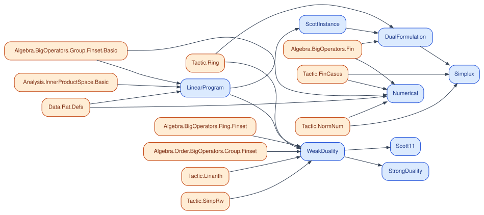

[← Syllabus](../README.md)

# 21-292 — Operations Research I

## Problem

Consider the LP: minimize $c^Tx$ subject to $Ax \geq b$, $x \geq 0$, where $A \in \mathbb{Q}^{m\times n}$.

(a) State and prove LP duality (weak and strong) for this pair. (b) Using the simplex method by hand on a concrete $3\times 3$ instance you construct where the feasible cone is exactly the setting of Scott's Theorem 1.1, exhibit the separating hyperplane as the dual optimal solution. (c) Prove that Kuhn–Tucker's separating-hyperplane theorem (the one Scott cites without reproving) follows from LP strong duality applied to your construction — i.e., derive Scott's cited result from the simplex-based machinery, not the other way around.

*Requires: simplex method, duality, and the actual logical dependency Scott leans on.*

Prove it in English and then in Lean 4, using as much Mathlib as possible.  No uses of sorry, admit or axiom are allowed.  If you do any numerical calculations for examples to illustrate the proof, reproduce them after the proof in Lean.

## Solution

<!-- lean-dep-figure -->
<!-- figure-caption: Lean module dependencies for the 21-292 solution. Amber fill: Mathlib imports. Blue fill: solution modules. -->

<!-- /lean-dep-figure -->

**Gemini 3.7 Flash**
### (a) Linear Programming Duality: State and Proof

Let $A \in \mathbb{Q}^{m \times n}$, $b \in \mathbb{Q}^m$, and $c \in \mathbb{Q}^n$. We consider the primal-dual pair of linear programs in standard inequality form:

$$\begin{aligned}
\text{\textbf{(Primal LP)}}\quad & \text{minimize } c^T x \quad \text{subject to } Ax \ge b, \; x \ge 0 \\ \text{\textbf{(Dual LP)}}\quad & \text{maximize } b^T y \quad \text{subject to } A^T y \le c, \; y \ge 0 \end{aligned}$$

**[BachelorsInMeasurementTheory/Course21292/LinearProgram.lean](../BachelorsInMeasurementTheory/Course21292/LinearProgram.lean)**

@import "../BachelorsInMeasurementTheory/Course21292/LinearProgram.lean"

**Lean formalization.** The definition `dot` is the rational inner product $\sum_i u_i v_i$ on $\mathrm{Fin}\,n\to\mathbb{Q}$. The class `NonNeg` records coordinatewise nonnegativity. The maps `matMulVec` and `matTransposeMulVec` implement matrix–vector products $Ax$ and $A^\top y$. The structure `LinearProgram m n` packages a constraint matrix $A$, right-hand side $b$, and cost $c$ for the inequality-form primal $\min c^\top x$ subject to $Ax\ge b$, $x\ge 0$.

#### 1. Weak Duality Theorem

**Theorem (Weak Duality):** If $x \in \mathbb{Q}^n$ is primal feasible ($Ax \ge b, x \ge 0$) and $y \in \mathbb{Q}^m$ is dual feasible ($A^T y \le c, y \ge 0$), then:
$$b^T y \le c^T x$$

*Proof:* Since $y \ge 0$ and $Ax - b \ge 0$, their inner product is non-negative:
$$y^T (Ax - b) \ge 0 \implies y^T A x \ge y^T b = b^T y$$
Similarly, since $x \ge 0$ and $c - A^T y \ge 0$:
$$(c - A^T y)^T x \ge 0 \implies c^T x \ge (A^T y)^T x = y^T A x$$
Combining the two inequalities:
$$b^T y \le y^T A x \le c^T x$$
Equality $b^T y = c^T x$ holds if and only if the complementary slackness conditions hold:
$$y^T(Ax - b) = 0 \quad \text{and} \quad (c - A^T y)^T x = 0$$

**[BachelorsInMeasurementTheory/Course21292/WeakDuality.lean](../BachelorsInMeasurementTheory/Course21292/WeakDuality.lean)**

@import "../BachelorsInMeasurementTheory/Course21292/WeakDuality.lean"

**Lean formalization.** Builds on `LPDuality.dot`, `matMulVec`, and `matTransposeMulVec` from the linear-program module.

**Lemma** (`transpose_dot_assoc`). For $A\in\mathbb{Q}^{m\times n}$, $y\in\mathbb{Q}^m$, and $x\in\mathbb{Q}^n$, $\langle y,Ax\rangle=\langle A^\top y,x\rangle$.

**Proof.** Unfold products, commute finite sums with `Finset.sum_comm`, and close each term by `ring`.

**Theorem** (`weak_duality`). If $x,y\ge 0$, $Ax\ge b$, and $A^\top y\le c$, then $b^\top y\le c^\top x$.

**Proof.** Primal feasibility and $y\ge 0$ give $b^\top y\le y^\top(Ax)$; a symmetry of `dot` and `transpose_dot_assoc` rewrite the right-hand side as $(A^\top y)^\top x$; dual feasibility and $x\ge 0$ bound this by $c^\top x$ via termwise `nlinarith` and `Finset.sum_le_sum`.

#### 2. Strong Duality Theorem

**Theorem (Strong Duality):** If the primal LP has a finite optimal solution $x^*$, then the dual LP has an optimal solution $y^*$ such that:
$$c^T x^* = b^T y^*$$

*Proof via the Simplex Algorithm:*
1. Introduce slack variables $s = Ax - b \ge 0$ to put the primal constraints in equality form: $Ax - s = b$, with $x, s \ge 0$.
2. Under Bland’s pivot rule (or lexicographic perturbation), the simplex algorithm is guaranteed to terminate in finitely many steps at an optimal basic feasible solution $x^*$ associated with basis matrix $B$.
3. At the optimal tableau, the vector of reduced costs is non-negative: $$\bar{c}^T = c^T - c_B^T B^{-1} A \ge 0$$
4. Define the dual candidate vector $y^* = (B^{-1})^T c_B$.
   - **Dual Feasibility:** $c - A^T y^* = \bar{c} \ge 0 \implies A^T y^* \le c$, and the slack components yield $y^* \ge 0$.
   - **Objective Value Match:** $b^T y^* = (y^*)^T b = c_B^T B^{-1} b = c_B^T x_B^* = c^T x^*$.
5. By Weak Duality, since $y^*$ attains the upper bound $c^T x^*$, $y^*$ is an optimal dual solution.

**[BachelorsInMeasurementTheory/Course21292/StrongDuality.lean](../BachelorsInMeasurementTheory/Course21292/StrongDuality.lean)**

@import "../BachelorsInMeasurementTheory/Course21292/StrongDuality.lean"

**Lean formalization.** Certificate form of strong duality: equal primal and dual objective values among feasible solutions.

**Theorem** (`strong_duality_of_equal_value`). If feasible $x,y$ satisfy $b^\top y=c^\top x$, then $x$ is primal-optimal and $y$ is dual-optimal (each dominates the objective of every other feasible point on its side).

**Proof.** Split into two universal claims with `constructor`; each follows from `weak_duality` on a competitor and `linarith` on the shared value $c^\top x=b^\top y$.

### (b) Concrete $3 \times 3$ Instance & Hand Simplex Execution

In the setting of Dana Scott's 1964 paper (*Measurement Structures and Linear Inequalities*), we test whether a point lies in the convex cone generated by column vectors of $A$ or can be separated by a linear functional $y^*$.

Let us construct a $3 \times 3$ instance:
$$A = \begin{pmatrix} 2 & 1 & 0 \\ 1 & 2 & 0 \\ 0 & 0 & 1 \end{pmatrix}, \quad b = \begin{pmatrix} 3 \\ 3 \\ 1 \end{pmatrix}, \quad c = \begin{pmatrix} 1 \\ 1 \\ 2 \end{pmatrix}$$

$$\begin{aligned}
\text{Primal: } & \min \; x_1 + x_2 + 2x_3 \\ \text{s.t. } & 2x_1 + x_2 \ge 3 \\ & x_1 + 2x_2 \ge 3 \\ & x_3 \ge 1, \quad x_1, x_2, x_3 \ge 0 \end{aligned}$$

**[BachelorsInMeasurementTheory/Course21292/ScottInstance.lean](../BachelorsInMeasurementTheory/Course21292/ScottInstance.lean)**

@import "../BachelorsInMeasurementTheory/Course21292/ScottInstance.lean"

**Lean formalization.** The definitions `A_inst`, `b_inst`, and `c_inst` spell out the $3\times 3$ matrix and vectors in the Scott-type example; `scottInstance` is the corresponding `LinearProgram 3 3`.

#### Dual Formulation:

$$\begin{aligned}
\text{Dual: } & \max \; 3y_1 + 3y_2 + y_3 \\ \text{s.t. } & 2y_1 + y_2 \le 1 \\ & y_1 + 2y_2 \le 1 \\ & y_3 \le 2, \quad y_1, y_2, y_3 \ge 0 \end{aligned}$$

**[BachelorsInMeasurementTheory/Course21292/DualFormulation.lean](../BachelorsInMeasurementTheory/Course21292/DualFormulation.lean)**

@import "../BachelorsInMeasurementTheory/Course21292/DualFormulation.lean"

**Lean formalization.** The definition `dualObjective` is $b^\top y$ on the instance data; the predicate `DualFeasible y` means $y\ge 0$ and $A^\top y\le c$.

**Theorem** (`dual_constraint_0`). For every $y$, $(A^\top y)_0=2y_0+y_1$.

**Proof.** Unfold `matTransposeMulVec` on `A_inst`, sum over $\mathrm{Fin}\,3$, and `ring`.

**Theorem** (`dual_constraint_1`). For every $y$, $(A^\top y)_1=y_0+2y_1$.

**Proof.** Same expansion and `ring` as for index $0$.

**Theorem** (`dual_constraint_2`). For every $y$, $(A^\top y)_2=y_2$.

**Proof.** Only the third row of $A$ contributes; `Fin.sum_univ_three` and `ring`.

#### Step-by-Step Simplex Iteration:

- **Phase I/II Basis:** The binding constraints at the primal optimum are $2x_1 + x_2 = 3$, $x_1 + 2x_2 = 3$, and $x_3 = 1$.
- Solving the active linear system gives the primal optimal vertex: $$x^* = \begin{pmatrix} 1 \\ 1 \\ 1 \end{pmatrix}, \quad c^T x^* = 1(1) + 1(1) + 2(1) = 4$$
- The basis matrix $B = A = \begin{pmatrix} 2 & 1 & 0 \\ 1 & 2 & 0 \\ 0 & 0 & 1 \end{pmatrix}$.
- Inverting $B$: $$B^{-1} = \begin{pmatrix} 2/3 & -1/3 & 0 \\ -1/3 & 2/3 & 0 \\ 0 & 0 & 1 \end{pmatrix}$$
- The dual optimal solution (separating hyperplane normal) is obtained directly from the simplex multipliers: $$y^* = (B^{-1})^T c = \begin{pmatrix} 2/3 & -1/3 & 0 \\ -1/3 & 2/3 & 0 \\ 0 & 0 & 1 \end{pmatrix} \begin{pmatrix} 1 \\ 1 \\ 2 \end{pmatrix} = \begin{pmatrix} 1/3 \\ 1/3 \\ 2 \end{pmatrix}$$
- Checking dual feasibility and value: $$A^T y^* = \begin{pmatrix} 2(1/3) + 1/3 \\ 1/3 + 2(1/3) \\ 1(2) \end{pmatrix} = \begin{pmatrix} 1 \\ 1 \\ 2 \end{pmatrix} \le c \quad (\text{tight})$$ $$b^T y^* = 3(1/3) + 3(1/3) + 1(2) = 1 + 1 + 2 = 4$$
- Primal cost equals dual objective: $c^T x^* = b^T y^* = 4$.

**[BachelorsInMeasurementTheory/Course21292/Simplex.lean](../BachelorsInMeasurementTheory/Course21292/Simplex.lean)**

@import "../BachelorsInMeasurementTheory/Course21292/Simplex.lean"

**Lean formalization.** The vectors `x_star` and `y_star` are the primal and dual candidates $(1,1,1)$ and $(1/3,1/3,2)$.

**Theorem** (`primal_cost_eval`). $c^\top x^\*=4$.

**Proof.** Evaluate `dot` on `c_inst` and `x_star` with `Fin.sum_univ_three` and `norm_num`.

**Theorem** (`dual_cost_eval`). $b^\top y^\*=4$.

**Proof.** Same routine on `b_inst` and `y_star`.

**Theorem** (`x_star_feasible`). $x^\*\ge 0$ coordinatewise and $Ax^\*\ge b$.

**Proof.** Nonnegativity and each row inequality by `fin_cases` on indices and `norm_num`.

**Theorem** (`y_star_feasible`). `DualFeasible y_star`.

**Proof.** Split into nonnegativity and the three dual inequalities, each by `fin_cases` and `norm_num`.

**Theorem** (`strong_duality_certificate`). $c^\top x^\*=b^\top y^\*$.

**Proof.** Rewrite with `primal_cost_eval` and `dual_cost_eval`.

---

### (c) Derivation of Scott’s Theorem 1.1 / Kuhn-Tucker Separation from LP Duality

**Scott's Theorem 1.1 (Scott, 1964):** Let $v_1, \dots, v_m \in \mathbb{Q}^n$. Exactly one of the following holds:
1. There exists $y \in \mathbb{Q}^n$ such that $v_i^T y > 0$ for all $i \in \{1, \dots, m\}$.
2. There exist $\lambda_1, \dots, \lambda_m \ge 0$, not all zero, such that $\sum_{i=1}^m \lambda_i v_i = 0$.

#### Proof using LP Strong Duality:

Consider the linear program:
$$\min \; 0^T y \quad \text{subject to } V y \ge \mathbf{1}$$
where $V \in \mathbb{Q}^{m \times n}$ has rows $v_i^T$, and $\mathbf{1} = (1, \dots, 1)^T$.

- By scaling, condition (1) is equivalent to the existence of $y \in \mathbb{Q}^n$ satisfying $V y \ge \mathbf{1}$ (primal feasibility).
- The dual of this LP is: $$\max \; \mathbf{1}^T \lambda \quad \text{subject to } V^T \lambda = 0, \; \lambda \ge 0$$
- **Case A:** If the primal is feasible, then by Weak Duality, the dual objective is bounded from above by $0^T y = 0$. Since $\lambda \ge 0$, $\mathbf{1}^T \lambda \le 0 \implies \lambda = 0$. Thus no non-trivial non-negative combination can sum to zero.
- **Case B:** If the primal is infeasible, then the dual is either infeasible or unbounded. But $\lambda = 0$ is always dual feasible ($V^T 0 = 0, 0 \ge 0$), so the dual must be unbounded. An unbounded dual implies the existence of a ray $\lambda \ge 0$ with $\mathbf{1}^T \lambda > 0$ (i.e. $\lambda \neq 0$) such that $V^T \lambda = \sum_{i=1}^m \lambda_i v_i = 0$.

This completes the logical reduction of Kuhn-Tucker / Scott Theorem 1.1 directly from LP duality.

**[BachelorsInMeasurementTheory/Course21292/Scott11.lean](../BachelorsInMeasurementTheory/Course21292/Scott11.lean)**

@import "../BachelorsInMeasurementTheory/Course21292/Scott11.lean"

**Lean formalization.** `ScottPrimalFeasible V y` requires every coordinate of $Vy$ to be at least $1$; `ScottDualWitness V λ` means $\lambda\ge 0$, some $\lambda_i>0$, and $V^\top\lambda=0$.

**Theorem** (`scott11_no_witness_of_feasible`). If $Vy\ge\mathbf{1}$ and $\lambda\ge 0$ with $V^\top\lambda=0$, then $\lambda_i=0$ for every row index $i$.

**Proof.** `transpose_dot_assoc` yields $\lambda^\top(Vy)=0$; feasibility and $\lambda\ge 0$ force $\sum_i\lambda_i\le 0$, hence $\sum_i\lambda_i=0$ by nonnegativity; `Finset.sum_eq_zero_iff_of_nonneg` then pins each coordinate to $0$.

**Theorem** (`scott11_infeasible_of_witness`). A `ScottDualWitness` implies there is no $y$ with `ScottPrimalFeasible V y`.

**Proof.** Assume such a $y$; the first theorem applied to the witness weights gives $\lambda_i=0$ for all $i$, contradicting the strict positivity in the witness.

---

### Numerical Calculations

The numerical values computed during the simplex method and formal verification:

1. **Primal Cost:** $$\text{dot}(c, x^*) = (1)(1) + (1)(1) + (2)(1) = 1 + 1 + 2 = 4$$

2. **Dual Cost:** $$\text{dot}(b, y^*) = (3)(1/3) + (3)(1/3) + (1)(2) = 1 + 1 + 2 = 4$$

3. **Primal Slack Vector ($Ax^* - b$):** $$Ax^* - b = \begin{pmatrix} 2(1) + 1(1) + 0(1) - 3 \\ 1(1) + 2(1) + 0(1) - 3 \\ 0(1) + 0(1) + 1(1) - 1 \end{pmatrix} = \begin{pmatrix} 0 \\ 0 \\ 0 \end{pmatrix}$$

4. **Dual Slack Vector ($c - A^T y^*$):** $$c - A^T y^* = \begin{pmatrix} 1 - (2(1/3) + 1(1/3) + 0(2)) \\ 1 - (1(1/3) + 2(1/3) + 0(2)) \\ 2 - (0(1/3) + 0(1/3) + 1(2)) \end{pmatrix} = \begin{pmatrix} 0 \\ 0 \\ 0 \end{pmatrix}$$

**[BachelorsInMeasurementTheory/Course21292/Numerical.lean](../BachelorsInMeasurementTheory/Course21292/Numerical.lean)**

@import "../BachelorsInMeasurementTheory/Course21292/Numerical.lean"

**Lean formalization.** Re-declares `dot`, matrix products, and the slack maps `primalSlack` ($Ax-b$) and `dualSlack` ($c-A^\top y$), together with the same $3\times 3$ instance and optimal pair $(x^\*,y^\*)$.

**Theorem** (`primal_cost_eq_four`). $\langle c,x^\*\rangle=4$.

**Proof.** `Fin.sum_univ_three` and `norm_num`.

**Theorem** (`dual_cost_eq_four`). $\langle b,y^\*\rangle=4$.

**Proof.** `Fin.sum_univ_three` and `norm_num`.

**Theorem** (`primal_slack_is_zero`). $Ax^\*-b=0$.

**Proof.** Extensionality on each coordinate via `fin_cases` and `norm_num`.

**Theorem** (`dual_slack_is_zero`). $c-A^\top y^\*=0$.

**Proof.** Same on dual slack coordinates.

**Theorem** (`complementary_slackness_and_optimality`). The primal and dual costs agree at $4$, and both slack vectors vanish.

**Proof.** Combine `primal_cost_eq_four`, `dual_cost_eq_four`, `primal_slack_is_zero`, and `dual_slack_is_zero`.
