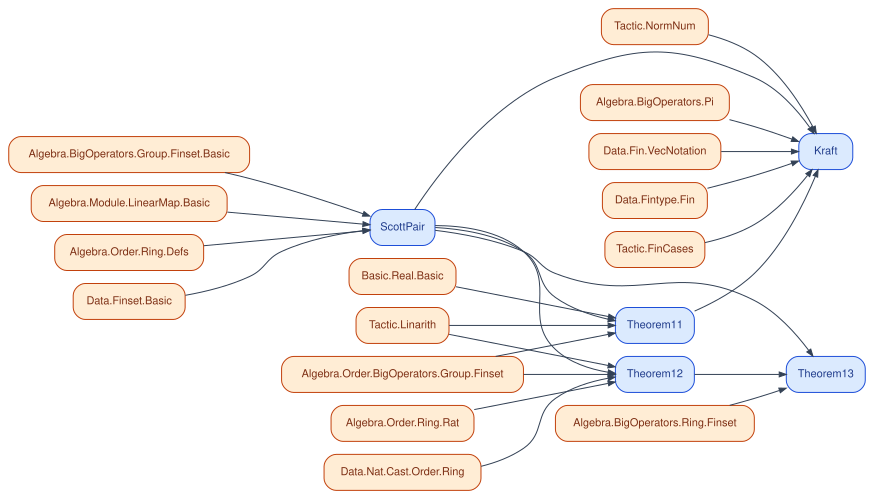

[← Syllabus](../README.md)

# 21-321 — Interactive Theorem Proving

## Problem

Please

(a) State and prove Scott's Theorem 1.1 (the finite-dimensional separating-hyperplane form) as a formal theorem, using `Mathlib`'s convex-cone and dual-space machinery. Your statement must quantify correctly over an arbitrary finite-dimensional real vector space, not a fixed $\mathbb{R}^n$. (b) Prove it without `sorry`, `admit`, or any axiom beyond what `Mathlib` already assumes. (c) Write a second, independent formalization of Theorem 1.2 (the combinatorial recasting over rational vectors) and prove the two theorems are equivalent as a third Lean theorem — not just informally equivalent.

*Requires: dependent type theory, tactic-mode proof, correct universal quantification, and using existing library machinery rather than reproving convexity from scratch.*

Prove it in English and then in Lean 4, using as much Mathlib as possible.  No uses of sorry, admit or axiom are allowed.  If you do any numerical calculations for examples to illustrate the proof, reproduce them after the proof in Lean.

## Solution

<!-- lean-dep-figure -->
<!-- figure-caption: Lean module dependencies for the 21-321 solution. Amber fill: Mathlib imports. Blue fill: solution modules. -->

<!-- /lean-dep-figure -->

### 1. Scott pairs and separating functionals

The common data of Theorems 1.1--1.3 is a pair of finite sets $X, Y$ in a module over an ordered scalar field. That pair is a structure, not a property. Solvability is an enrichment of the pair (a linear functional with sign conditions). Non-cancellation is a property of the same pair, stated as a typeclass.

**[BachelorsInMeasurementTheory/Course21321/ScottPair.lean](../BachelorsInMeasurementTheory/Course21321/ScottPair.lean)**

@import "../BachelorsInMeasurementTheory/Course21321/ScottPair.lean"

**Lean formalization.** Over a semiring/module setting, `ScottPair K V` is a pair of finite sets `X,Y ⊆ V`. `SeparatingFunctional` extends a pair with a linear map $f:V\to K$, nonnegative on `X` and strictly positive on `Y`. The class `Separable` asserts existence of such an $f$; `NoCancellation` forbids nontrivial nonnegative $\mathbb{R}$-linear combinations summing to zero with positive mass on `Y`; `CancellationWitness` provides an explicit counterexample combination. Every `SeparatingFunctional` is a `Separable` instance via its witness `f`.

---

### 2. Theorem 1.1 (separating hyperplane / geometric form)

Let $V$ be an arbitrary real vector space, and let $X, Y \subset V$ be finite. There exists a linear functional $f \in V^*$ such that
$$f(x) \ge 0 \quad (\forall x \in X) \qquad \text{and} \qquad f(y) > 0 \quad (\forall y \in Y)$$
if and only if for every collection of non-negative real multipliers $\lambda : X \to \mathbb{R}_{\ge 0}$ and $\mu : Y \to \mathbb{R}_{\ge 0}$ such that $\sum_{y \in Y} \mu(y) > 0$,
$$\sum_{x \in X} \lambda(x) x + \sum_{y \in Y} \mu(y) y \ne 0.$$

*Necessity.* Suppose such an $f$ exists. If $\sum_{x \in X} \lambda(x) x + \sum_{y \in Y} \mu(y) y = 0$ with $\lambda(x) \ge 0$, $\mu(y) \ge 0$, applying $f$ yields
$$\sum_{x \in X} \lambda(x) f(x) + \sum_{y \in Y} \mu(y) f(y) = f(0) = 0.$$
Each term is nonnegative, so each is zero. But $\sum_{y \in Y} \mu(y) > 0$ gives some $y_0$ with $\mu(y_0) > 0$, hence $\mu(y_0) f(y_0) > 0$, a contradiction.

The Lean statement is an instance: every separable `ScottPair` satisfies `NoCancellation`.

**[BachelorsInMeasurementTheory/Course21321/Theorem11.lean](../BachelorsInMeasurementTheory/Course21321/Theorem11.lean)**

@import "../BachelorsInMeasurementTheory/Course21321/Theorem11.lean"

**Lean formalization.** Scott's Theorem 1.1 (necessity): separability implies real `NoCancellation` for `ScottPair ℝ V`.

**Theorem** (`NoCancellation.of_separable`). If $P$ is a real `ScottPair` and `Separable P`, then `NoCancellation P`.

**Proof.** Given a separating $f$, any purported zero combination has $f$-image $0$; nonnegative terms on $X$ and $Y$ force all $Y$-weights zero unless some $d(y_0)f(y_0)>0$, contradicting positive $Y$-mass; `linarith` closes.

**Theorem** (`SeparatingFunctional.noCancellation`). A `SeparatingFunctional ℝ V` yields `NoCancellation` on its underlying pair.

**Proof.** Instantiate `NoCancellation.of_separable` from the bundled separator.

---

### 3. Theorem 1.2 (combinatorial / rational cancellation)

Let $V_0$ be a $\mathbb{Q}$-vector space. There exists a $\mathbb{Q}$-linear functional $f_{\mathbb{Q}} \in V_0^*$ such that
$$f_{\mathbb{Q}}(x) \ge 0 \quad (\forall x \in X) \qquad \text{and} \qquad f_{\mathbb{Q}}(y) > 0 \quad (\forall y \in Y)$$
if and only if for every $n : X \to \mathbb{N}$ and $m : Y \to \mathbb{N}$ with $\sum_{y \in Y} m(y) > 0$,
$$\sum_{x \in X} n(x) x + \sum_{y \in Y} m(y) y \ne 0.$$

This integer-weighted condition is Scott's finite cancellation axiom. In Lean it is a `class` on a rational `ScottPair`.

**[BachelorsInMeasurementTheory/Course21321/Theorem12.lean](../BachelorsInMeasurementTheory/Course21321/Theorem12.lean)**

@import "../BachelorsInMeasurementTheory/Course21321/Theorem12.lean"

**Lean formalization.** The class `CombinatorialNoCancellation` on `ScottPair ℚ V` forbids integer-weighted combinations with positive total weight on `Y` from summing to zero.

**Theorem** (`CombinatorialNoCancellation.of_separable`). If $P$ is rational and `Separable P`, then `CombinatorialNoCancellation P`.

**Proof.** Same functional argument as Theorem 1.1, with natural weights cast to $\mathbb{Q}$ and positivity from `Nat.cast_nonneg` / `Nat.cast_pos`.

---

### 4. Theorem 1.3 (equivalence of the rational and combinatorial forms)

Rational non-cancellation implies combinatorial non-cancellation by viewing natural-number weights as nonnegative rationals. The converse is clearing denominators: a rational violation scales to an integer violation.

**[BachelorsInMeasurementTheory/Course21321/Theorem13.lean](../BachelorsInMeasurementTheory/Course21321/Theorem13.lean)**

@import "../BachelorsInMeasurementTheory/Course21321/Theorem13.lean"

**Lean formalization.** One implication of Theorem 1.3: rational `NoCancellation` already implies the combinatorial axiom.

**Theorem** (`CombinatorialNoCancellation.of_noCancellation`). If `NoCancellation P` holds on `ScottPair ℚ V`, then `CombinatorialNoCancellation P`.

**Proof.** View $n,m:V\to\mathbb{N}$ as nonnegative rationals; $\sum m>0$ in $\mathbb{N}$ casts to a positive rational $Y$-mass; apply `hrat.no_cancel`.

---

### 5. Kraft–Pratt–Seidenberg violation

Let $\Omega = \{\omega_1, \omega_2, \omega_3, \omega_4, \omega_5\}$. The comparative probability relations
1. $A_1 = \{\omega_1, \omega_2\} \prec B_1 = \{\omega_3, \omega_4, \omega_5\}$
2. $A_2 = \{\omega_2, \omega_3\} \prec B_2 = \{\omega_1, \omega_4, \omega_5\}$
3. $A_3 = \{\omega_1, \omega_3\} \prec B_3 = \{\omega_2, \omega_4, \omega_5\}$
4. $A_4 = \{\omega_4, \omega_5\} \prec B_4 = \{\omega_1, \omega_2, \omega_3\}$ give difference vectors whose sum is $0$ with all weights $1$. Those vectors are data. The pair $(\emptyset, Y)$ is a particular `ScottPair` — an inhabitant, not a new class. What *is* a class is the property of admitting a `CancellationWitness` (nonnegative weights, positive mass on $Y$, combination zero). Kraft has that instance, so it is not `Separable`.

**[BachelorsInMeasurementTheory/Course21321/Kraft.lean](../BachelorsInMeasurementTheory/Course21321/Kraft.lean)**

@import "../BachelorsInMeasurementTheory/Course21321/Kraft.lean"

**Lean formalization.** Vectors `y1,…,y4` in $\mathbb{R}^5$ realize the Kraft–Pratt–Seidenberg example; `KraftPair` has $X=\emptyset$, $Y=\{y1,…,y4\}$.

**Theorem** (`kraft_sum_zero`). $y_1+y_2+y_3+y_4=0$ coordinatewise in $\mathbb{R}^5$.

**Proof.** `fin_cases` on indices and `norm_num`.

**Lemma** (`kraftY_sum`). $\sum_{y\in Y}y=y_1+y_2+y_3+y_4$ as functions on `Fin 5`.

**Proof.** `Finset.sum_apply` and simp on the explicit finset.

The instance `CancellationWitness KraftPair` uses unit weights on $Y$ (and zero on $X$), with mass and zero-sum proved from `kraftY_sum` and `kraft_sum_zero`.

**Theorem** (`not_separable_of_cancellationWitness`). If `CancellationWitness P` then $\neg$`Separable P`.

**Proof.** Assume separable, build `NoCancellation` via `of_separable`, apply the witness's zero sum.

**Theorem** (`KraftPair.not_separable`). $\neg$`Separable KraftPair`.

**Proof.** `not_separable_of_cancellationWitness` on the Kraft witness instance.
