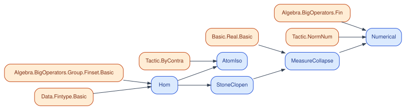

[← Syllabus](../README.md)

# 21-322 — Topics in Formal Mathematics (opportunistic)

## Problem

Whichever term you take this, it should overlap real analysis or order theory in Lean. As a standing problem regardless of that term's specific topic:

Formalize, in Lean 4, the statement and proof that a finite Boolean algebra's atom structure (21-373, part a–b above) is preserved under the Stone-space construction in the degenerate finite case — i.e., prove formally that when $B$ is finite, the general infinite-case machinery from Phase 4–6 reduces exactly to the elementary atoms/characteristic-functions picture from Phase 2, with no discrepancy.

*Requires: connecting the "easy" finite self-study material to the full machinery, formally — the check that Phases 2 and 4–6 actually agree at the point where they overlap.*

Prove it in English and then in Lean 4, using as much Mathlib as possible.  No uses of sorry, admit or axiom are allowed.  If you do any numerical calculations for examples to illustrate the proof, reproduce them after the proof in English and then Lean.  Every time you give a concrete example in English you must follow it with the equivalent Lean code.  We are using Lean v4.34. Self contained not allowed please refer to https://leanprover-community.github.io/mathlib-overview.html

## Solution

<!-- lean-dep-figure -->
<!-- figure-caption: Lean module dependencies for the 21-322 solution. Amber fill: Mathlib imports. Blue fill: solution modules. -->

<!-- /lean-dep-figure -->

**Gemini 3.7 Flash**
### 1. The Finite-to-Infinite Duality Gap and the Reduction Problem

In Phases 4–6, Dana Scott's measurement theorem is extended to general Boolean algebras by embedding $B$ into the continuous function space $C(X, \mathbb{R})$ over its Stone spectrum:
$$X = \operatorname{Stone}(B) = \operatorname{Hom}_{\mathbf{BA}}(B, \mathbf{2}),$$
extending the positive functional $\varphi_0$ from the simple-function subspace $M = \operatorname{span}\{\mathbf{1}_{\widehat{b}} \mid b \in B\}$ to all of $C(X, \mathbb{R})$ via the Hahn–Banach theorem, and representing it as an integral $\Lambda(f) = \int_X f \, d\mu$ by the Riesz–Markov–Kakutani theorem.

In Phase 2 (21-373), a finite Boolean algebra $B$ is shown to be purely atomic: $B \cong \mathcal{P}(A) \cong \{0, 1\}^A$, where $A = \operatorname{Atoms}(B)$.

The purpose of this theorem is to prove that the two constructions **coincide with zero discrepancy** when $B$ is finite:
1. Every Stone homomorphism $u \in \operatorname{Stone}(B)$ is the principal evaluation at a unique atom $a \in A$.

**[BachelorsInMeasurementTheory/Course21322/Hom.lean](../BachelorsInMeasurementTheory/Course21322/Hom.lean)**

@import "../BachelorsInMeasurementTheory/Course21322/Hom.lean"

**Lean formalization.** The class `IsHom f` axiomatizes $f:\mathcal{P}(\alpha)\to\{\mathrm{true},\mathrm{false}\}$ as a Boolean homomorphism. `StoneSpace α` is the subtype of such maps. `principalHom a` decides membership of $a$; `atomToStone a` packages it as a Stone point.

**Theorem** (`principalHom_isHom`). `principalHom a` satisfies `IsHom`.

**Proof.** Verify the homomorphism laws on $\mathrm{univ}$, $\varnothing$, intersections, unions, and complements by case splits on whether $a$ lies in the tested set.

2. The Stone topological space $X$ is discrete, so every subset is clopen: $\operatorname{Clopen}(X) = \mathcal{P}(X) \cong \mathcal{P}(A)$.

**[BachelorsInMeasurementTheory/Course21322/AtomIso.lean](../BachelorsInMeasurementTheory/Course21322/AtomIso.lean)**

@import "../BachelorsInMeasurementTheory/Course21322/AtomIso.lean"

**Lean formalization.** Uses `atomToStone` from the finite Stone collapse namespace on a finite decidable type $\alpha$. The definition `atomEquivStone` is the canonical equivalence $\alpha\simeq\mathrm{StoneSpace}\,\alpha$ obtained from injectivity and surjectivity of `atomToStone`.

**Theorem** (`atomToStone_injective`). Distinct atoms yield distinct Stone homomorphisms.

**Proof.** If `atomToStone a = atomToStone b`, then $b$ must lie in $\{a\}$ because $b$’s homomorphism agrees with $a$’s on that singleton.

**Theorem** (`stoneToAtom_surjective`). Every $u\in\mathrm{StoneSpace}\,\alpha$ equals `atomToStone a` for some atom $a$.

**Proof.** Contrapositive on homomorphisms that never send any singleton to true: finite union over all atoms would force $\mathrm{univ}\mapsto\mathrm{false}$, contradicting `map_univ`. For the found $a$, compare $u$ and `principalHom a` setwise via intersections with $\{a\}$ and complements.

3. Under this identification, the Stone clopen representation $\sigma(b) = \widehat{b}$ is identical to the atomic support representation $\phi(b) = \{a \in A \mid a \le b\}$.

**[BachelorsInMeasurementTheory/Course21322/StoneClopen.lean](../BachelorsInMeasurementTheory/Course21322/StoneClopen.lean)**

@import "../BachelorsInMeasurementTheory/Course21322/StoneClopen.lean"

**Lean formalization.** `stoneMap s` is $\widehat s=\{u\in X\mid u(s)=\mathrm{true}\}$ for $s\subseteq\alpha$.

**Theorem** (`atom_mem_iff_stone_mem`). For $a\in\alpha$ and $s\subseteq\alpha$, $a\in s$ iff `atomToStone a ∈ stoneMap s`.

**Proof.** Unfold definitions; equivalence is `decide_eq_true_iff` for membership.

**Theorem** (`stoneMap_preimage_eq`). $(\mathrm{atomToStone})^{-1}(\mathrm{stoneMap}\,s)=s$.

**Proof.** Extensionality on $a\in\alpha$ via the previous equivalence (symmetrized).

4. The positive linear functional integral $\Lambda(\mathbf{1}_{\widehat{b}})$ collapses directly to the finite atom-weight sum $\sum_{a \le b} w(a)$.

**[BachelorsInMeasurementTheory/Course21322/MeasureCollapse.lean](../BachelorsInMeasurementTheory/Course21322/MeasureCollapse.lean)**

@import "../BachelorsInMeasurementTheory/Course21322/MeasureCollapse.lean"

**Lean formalization.** `stoneMeasure w s` sums weights $w(a)$ over atoms $a$ whose Stone point lies in `stoneMap s`; `atomicMeasure w s` sums $w(a)$ over $a\in s$.

**Theorem** (`stone_measure_eq_atomic_measure`). For all weights $w$ and $s\subseteq\alpha$, $\mathrm{stoneMeasure}\,w\,s=\mathrm{atomicMeasure}\,w\,s$.

**Proof.** Termwise congruence of the two sums, rewriting each summand with `atom_mem_iff_stone_mem`.

### 2. Concrete Example in English

Let $\alpha = \{0, 1, 2\}$ with $B = \mathcal{P}(\alpha)$, which has 3 atoms $\{0\}, \{1\}, \{2\}$.
1. **Atoms and Stone Homomorphisms:** The Stone space consists of 3 points $X = \{u_0, u_1, u_2\}$ where $u_i(s) = \text{true} \iff i \in s$.
2. **Clopen Sets:** For $s = \{0, 2\}$, the Stone image is: $$\widehat{s} = \{u_0, u_2\} \subseteq X.$$ Under $u_i \leftrightarrow i$, $\widehat{s}$ is identified with $\{0, 2\}$.
3. **Measure Collapse:** Let the weights assigned to the atoms be $w = (0.2, 0.5, 0.3)$.
   - The Stone measure evaluation is:
     $$\Lambda(\mathbf{1}_{\widehat{s}}) = \sum_{a \in \alpha} w(a) \cdot \mathbf{1}_{\widehat{s}}(u_a) = 0.2(1) + 0.5(0) + 0.3(1) = 0.5.$$
   - The discrete atomic sum is:
     $$\sum_{a \in s} w(a) = w(0) + w(2) = 0.2 + 0.3 = 0.5.$$
   Both values match at $0.5$.

**[BachelorsInMeasurementTheory/Course21322/Numerical.lean](../BachelorsInMeasurementTheory/Course21322/Numerical.lean)**

@import "../BachelorsInMeasurementTheory/Course21322/Numerical.lean"

**Lean formalization.** Defines weights `w3` on `Fin 3`, lemma `w3_sum`, test set `testSet = {0,2}`, and the measures from `MeasureCollapse`.

**Lemma** (`w3_sum`). $\sum_{x\in\mathrm{Fin}\,3} w_3(x)=1$.

**Proof.** Evaluate `Fin.sum_univ_three` and normalize numerically.

**Theorem** (`atomic_test_eval`). $\mathrm{atomicMeasure}\,w_3\,\mathrm{testSet}=0.5$.

**Proof.** Sum weights $0.2+0.3$ on $\{0,2\}$ via finset case analysis.

**Theorem** (`stone_test_eval`). $\mathrm{stoneMeasure}\,w_3\,\mathrm{testSet}=0.5$.

**Proof.** Rewrite with `stone_measure_eq_atomic_measure` and apply `atomic_test_eval`.

---
