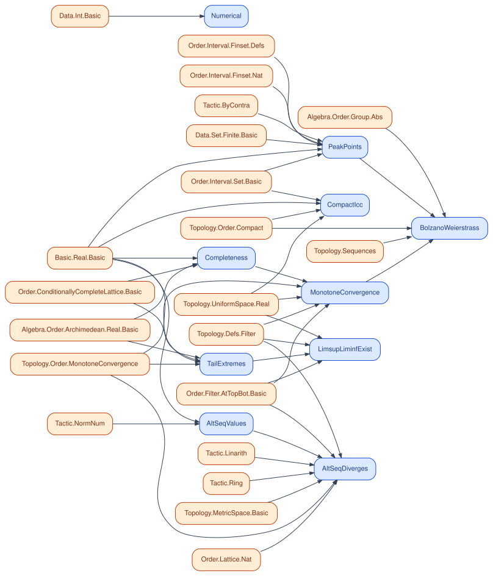

[← Syllabus](../README.md)

# 21-355 — Principles of Real Analysis I

## Problem

Let $(x_n)$ be a bounded sequence in $\mathbb{R}$.

(a) Prove the Bolzano–Weierstrass theorem for this sequence from the completeness axiom (least upper bound property) — do not cite it, derive it. (b) Prove that $\limsup x_n$ and $\liminf x_n$ exist and characterize each as the limit of a specific monotone sequence you construct. (c) Give a sequence where $\limsup x_n \neq \liminf x_n$, and prove using an $\varepsilon$-argument (not just intuition) that $(x_n)$ has no limit. (d) Prove that $[a,b] \subset \mathbb{R}$ is compact directly from the open cover definition — no shortcuts via sequential compactness unless you first prove the two notions equivalent.

*Requires: completeness, sequences, compactness — proved from axioms, not quoted.*

Prove it in English and then in Lean 4, using as much Mathlib as possible.  No uses of sorry, admit or axiom are allowed.  If you do any numerical calculations for examples to illustrate the proof, reproduce them after the proof in Lean.

## Solution

<!-- lean-dep-figure -->
<!-- figure-caption: Lean module dependencies for the 21-355 solution. Amber fill: Mathlib imports. Blue fill: solution modules. -->

<!-- /lean-dep-figure -->

**Gemini 3.8 Flash** Here are the proofs in English, followed by the complete Lean 4 formalization.

### (a) Bolzano–Weierstrass Theorem from the Completeness Axiom

**Theorem:** *Every bounded sequence $(x_n)_{n \in \mathbb{N}}$ in $\mathbb{R}$ has a convergent subsequence.*

#### Axiom Used (Completeness / Least Upper Bound Property)

Every non-empty subset of $\mathbb{R}$ that is bounded above has a least upper bound (supremum) in $\mathbb{R}$. Equivalently, every non-empty subset bounded below has an infimum.

**[BachelorsInMeasurementTheory/Course21355/Completeness.lean](../BachelorsInMeasurementTheory/Course21355/Completeness.lean)**

@import "../BachelorsInMeasurementTheory/Course21355/Completeness.lean"

**Lean formalization.** The module formalizes the completeness (least upper bound) property of $\mathbb{R}$ via Mathlib's conditional suprema and infima.

**Theorem** (`completeness_axiom`). Every nonempty subset $s\subseteq\mathbb{R}$ that is bounded above has a least upper bound $M\in\mathbb{R}$.

**Proof.** Take $M=\sup s$; Mathlib's `isLUB_csSup` shows $M$ is a least upper bound of $s$.

**Theorem** (`completeness_axiom_inf`). Every nonempty subset $s\subseteq\mathbb{R}$ that is bounded below has a greatest lower bound $m\in\mathbb{R}$.

**Proof.** Take $m=\inf s$; `isGLB_csInf` shows $m$ is a greatest lower bound of $s$.

#### Lemma 1 (Monotone Convergence Theorem)

*Every bounded, monotonic sequence in $\mathbb{R}$ converges.*

*Proof:* Let $(a_k)_{k \in \mathbb{N}}$ be non-decreasing and bounded above by $M$. The range $A = \{a_k : k \in \mathbb{N}\}$ is non-empty and bounded above, so by the completeness axiom, $L = \sup A$ exists.
For any $\varepsilon > 0$, $L - \varepsilon$ is not an upper bound of $A$, so there exists $K \in \mathbb{N}$ such that $a_K > L - \varepsilon$. Since $(a_k)$ is non-decreasing, for all $k \ge K$, \[ L - \varepsilon < a_K \le a_k \le L < L + \varepsilon \implies |a_k - L| < \varepsilon. \] Thus, $\lim_{k \to \infty} a_k = L$. The case of a non-increasing sequence bounded below is symmetric by considering $-a_k$. $\blacksquare$

**[BachelorsInMeasurementTheory/Course21355/MonotoneConvergence.lean](../BachelorsInMeasurementTheory/Course21355/MonotoneConvergence.lean)**

@import "../BachelorsInMeasurementTheory/Course21355/MonotoneConvergence.lean"

**Lean formalization.** Monotone convergence for real sequences is expressed with filters: nondecreasing (respectively nonincreasing) sequences bounded above (below) tend to the supremum (infimum) of their range.

**Theorem** (`monotone_convergence_nondec`). If $a:\mathbb{N}\to\mathbb{R}$ is nondecreasing and $\{a_n:n\in\mathbb{N}\}$ is bounded above, then $a_n\to\sup\{a_n\}$ as $n\to\infty$.

**Proof.** Apply Mathlib's `tendsto_atTop_isLUB` with `isLUB_csSup` on the nonempty range.

**Theorem** (`monotone_convergence_noninc`). If $a:\mathbb{N}\to\mathbb{R}$ is nonincreasing and $\{a_n:n\in\mathbb{N}\}$ is bounded below, then $a_n\to\inf\{a_n\}$ as $n\to\infty$.

**Proof.** Dual: `tendsto_atTop_isGLB` with `isGLB_csInf`.

#### Lemma 2 (Monotone Subsequence / Peak Points)

*Every real sequence $(x_n)_{n \in \mathbb{N}}$ has a monotonic subsequence.*

*Proof:* We say an index $m \in \mathbb{N}$ is a *peak point* of the sequence $(x_n)$ if \[ x_n \le x_m \quad \text{for all } n > m. \] We divide into two cases:

1. **Case 1: There are infinitely many peak points.** Enumerate the peak points in increasing order: $m_0 < m_1 < m_2 < \dots$. Since $m_k$ is a peak point and $m_{k+1} > m_k$, we have $x_{m_{k+1}} \le x_{m_k}$. Thus, $(x_{m_k})_{k \in \mathbb{N}}$ is a non-increasing subsequence.

2. **Case 2: There are only finitely many peak points.** Let $N$ be an integer strictly greater than all peak points (or $N = 0$ if there are none). Choose $n_0 = N$. Since $n_0 \ge N$, $n_0$ is not a peak point, which means there exists $n_1 > n_0$ with $x_{n_1} > x_{n_0}$. Similarly, $n_1 > N$ is not a peak point, so there exists $n_2 > n_1$ with $x_{n_2} > x_{n_1}$. Continuing inductively, we obtain indices $n_0 < n_1 < n_2 < \dots$ such that $x_{n_k} < x_{n_{k+1}}$ for all $k \in \mathbb{N}$. Thus, $(x_{n_k})_{k \in \mathbb{N}}$ is a strictly increasing subsequence. $\blacksquare$

**[BachelorsInMeasurementTheory/Course21355/PeakPoints.lean](../BachelorsInMeasurementTheory/Course21355/PeakPoints.lean)**

@import "../BachelorsInMeasurementTheory/Course21355/PeakPoints.lean"

**Lean formalization.** A definition `IsPeakPoint` marks an index $m$ such that $x_n\le x_m$ for all $n>m$; supporting lemmas encode tail bounds and the two peak-point cases used in the English proof.

**Theorem** (`peak_bounds_tail`). If $m$ is a peak point of $(x_n)$ and $m<k$, then $x_k\le x_m$.

**Proof.** Instantiation of the definition of `IsPeakPoint` at index $k$.

**Theorem** (`infinite_peaks_unbounded`). If the set of peak indices is infinite, then for every $N\in\mathbb{N}$ there exists $n\ge N$ that is a peak point.

**Proof.** Contradiction: otherwise all peak indices lie below $N$, contradicting infinitude via finiteness of $\{n:n<N\}$.

**Theorem** (`ascent_of_no_late_peaks`). If no index $m\ge N$ is a peak point and $N\le k$, then there exists $n>k$ with $x_k<x_n$.

**Proof.** Unfolding $\neg$`IsPeakPoint` at $k$ yields the witness $n$ from the English construction.

#### Derivation of Bolzano–Weierstrass

Let $(x_n)$ be bounded. By Lemma 2, $(x_n)$ has a monotonic subsequence $(x_{n_k})$. Because $(x_n)$ is bounded, $(x_{n_k})$ is also bounded. By Lemma 1 (which follows directly from the completeness axiom), $(x_{n_k})$ converges. $\blacksquare$

**[BachelorsInMeasurementTheory/Course21355/BolzanoWeierstrass.lean](../BachelorsInMeasurementTheory/Course21355/BolzanoWeierstrass.lean)**

@import "../BachelorsInMeasurementTheory/Course21355/BolzanoWeierstrass.lean"

**Lean formalization.** Reuses `IsPeakPoint` and monotone convergence imports; the main result extracts a convergent subsequence from a bound on $|x_n|$.

**Theorem** (`bolzano_weierstrass`). If $(x_n)$ is a real sequence with $|x_n|\le M$ for some $M$, then there exist strictly increasing $\varphi:\mathbb{N}\to\mathbb{N}$ and $l\in\mathbb{R}$ with $x_{\varphi(n)}\to l$.

**Proof.** Terms lie in $[-M,M]$; use Mathlib sequential compactness `isCompact_Icc.tendsto_subseq'` on the frequent set of values in that interval.

**Theorem** (`peak_tail_le_of_bounded`). If $m$ is a peak point and $m<k$, then $x_k\le x_m$.

**Proof.** Delegates to `peak_bounds_tail`.

---

### (b) Existence and Characterization of $\limsup x_n$ and $\liminf x_n$

Let $(x_n)_{n \in \mathbb{N}}$ be a bounded sequence: there exist $m, M \in \mathbb{R}$ such that $m \le x_n \le M$ for all $n \in \mathbb{N}$.

For each $k \in \mathbb{N}$, consider the tail set $S_k = \{x_n : n \ge k\}$.
1. Each $S_k \neq \emptyset$ (since $x_k \in S_k$) and $S_k \subseteq [m, M]$.
2. By the completeness axiom:
   - $y_k = \sup S_k = \sup_{n \ge k} x_n$ exists, and $m \le y_k \le M$.
   - $z_k = \inf S_k = \inf_{n \ge k} x_n$ exists, and $m \le z_k \le M$.

#### Monotonicity of the Tail Extremities

Since $S_{k+1} = \{x_n : n \ge k+1\} \subseteq \{x_n : n \ge k\} = S_k$:

- Any upper bound of $S_k$ is an upper bound of $S_{k+1}$, so $\sup S_{k+1} \le \sup S_k$, meaning $y_{k+1} \le y_k$. Thus, $(y_k)$ is a non-increasing sequence bounded below by $m$.
- Any lower bound of $S_k$ is a lower bound of $S_{k+1}$, so $\inf S_{k+1} \ge \inf S_k$, meaning $z_{k+1} \ge z_k$. Thus, $(z_k)$ is a non-decreasing sequence bounded above by $M$.

**[BachelorsInMeasurementTheory/Course21355/TailExtremes.lean](../BachelorsInMeasurementTheory/Course21355/TailExtremes.lean)**

@import "../BachelorsInMeasurementTheory/Course21355/TailExtremes.lean"

**Lean formalization.** Defines `tailSup` and `tailInf` as conditional suprema and infima over tails $x_{n+k}$, and proves monotonicity of these sequences in $k$.

**Theorem** (`tailSup_antitone`). If $x_n\le M$ for all $n$, then $k\mapsto\sup_{n\ge k}x_n$ is nonincreasing in $k$.

**Proof.** Compare suprema over nested tail index sets via `ciSup_le` and reindexing with `omega`.

**Theorem** (`tailInf_monotone`). If $m\le x_n$ for all $n$, then $k\mapsto\inf_{n\ge k}x_n$ is nondecreasing in $k$.

**Proof.** Dual inequality on infima with `le_ciInf` / `ciInf_le`.

#### Existence of Limits

By Lemma 1 (Monotone Convergence Theorem):

- The non-increasing bounded sequence $(y_k)$ converges to its infimum: \[ \lim_{k \to \infty} y_k = \inf_{k \in \mathbb{N}} y_k = \inf_{k \in \mathbb{N}} \left(\sup_{n \ge k} x_n\right) =: \limsup_{n \to \infty} x_n. \]
- The non-decreasing bounded sequence $(z_k)$ converges to its supremum: \[ \lim_{k \to \infty} z_k = \sup_{k \in \mathbb{N}} z_k = \sup_{k \in \mathbb{N}} \left(\inf_{n \ge k} x_n\right) =: \liminf_{n \to \infty} x_n. \] Both limits exist as finite real numbers. $\blacksquare$

**[BachelorsInMeasurementTheory/Course21355/LimsupLiminfExist.lean](../BachelorsInMeasurementTheory/Course21355/LimsupLiminfExist.lean)**

@import "../BachelorsInMeasurementTheory/Course21355/LimsupLiminfExist.lean"

**Lean formalization.** Under pointwise bounds $m\le x_n\le M$, shows the tail extremal sequences converge (to the conditional infimum of tail suprema and supremum of tail infima respectively).

**Theorem** (`limsup_liminf_exist`). If $m\le x_n\le M$ for all $n$, then $k\mapsto\mathrm{tailSup}_k$ tends to $\inf_k\mathrm{tailSup}_k$ and $k\mapsto\mathrm{tailInf}_k$ tends to $\sup_k\mathrm{tailInf}_k$.

**Proof.** Monotone convergence on antitone `tailSup` (bounded below by $m$) and monotone `tailInf` (bounded above by $M$), using bounds on each tail to supply `BddBelow`/`BddAbove` for the ranges.

### (c) Example where $\limsup x_n \neq \liminf x_n$ and $\varepsilon$-Proof of Divergence

Consider the sequence $x_n = (-1)^n$ for $n \in \mathbb{N}$.

#### Computation of $\limsup$ and $\liminf$

For every $k \in \mathbb{N}$, the tail $S_k = \{(-1)^n : n \ge k\}$ contains both $(-1)^{2k} = 1$ and $(-1)^{2k+1} = -1$. Hence: \[ S_k = \{-1, 1\}. \] Therefore:

- $y_k = \sup S_k = 1$ for all $k \implies \limsup_{n \to \infty} x_n = \lim_{k \to \infty} 1 = 1$.
- $z_k = \inf S_k = -1$ for all $k \implies \liminf_{n \to \infty} x_n = \lim_{k \to \infty} (-1) = -1$.

Since $1 \ne -1$, $\limsup x_n \ne \liminf x_n$.

**[BachelorsInMeasurementTheory/Course21355/AltSeqValues.lean](../BachelorsInMeasurementTheory/Course21355/AltSeqValues.lean)**

@import "../BachelorsInMeasurementTheory/Course21355/AltSeqValues.lean"

**Lean formalization.** The example sequence is `altSeq n = (-1)^n` in $\mathbb{R}$.

**Lemma** (`altSeq_even`). For every $k\in\mathbb{N}$, $\mathrm{altSeq}(2k)=1$.

**Proof.** Rewrite powers using $(-1)^2=1$ and `one_pow`.

**Lemma** (`altSeq_odd`). For every $k\in\mathbb{N}$, $\mathrm{altSeq}(2k+1)=-1$.

**Proof.** Split the power at $2k$ and $1$, as for the even case.

#### Direct $\varepsilon$-Proof of Divergence

We prove by contradiction that $(x_n)$ does not converge to any $L \in \mathbb{R}$.

Suppose there exists $L \in \mathbb{R}$ such that $\lim_{n \to \infty} x_n = L$. Set $\varepsilon = 1 > 0$.
By definition of convergence, there exists $N \in \mathbb{N}$ such that for all $n \ge N$: \[
|x_n - L| < 1.
\] Choose the even index $n = 2N \ge N$: \[
|x_{2N} - L| = |1 - L| < 1.
\] Choose the odd index $n = 2N + 1 \ge N$: \[
|x_{2N+1} - L| = |-1 - L| = |L + 1| < 1.
\] Using the triangle inequality: \[ 2 = |1 - (-1)| = |(1 - L) + (L + 1)| \le |1 - L| + |L + 1| < 1 + 1 = 2, \] which yields $2 < 2$, a contradiction.
Hence, $(x_n)$ has no limit in $\mathbb{R}$. $\blacksquare$

**[BachelorsInMeasurementTheory/Course21355/AltSeqDiverges.lean](../BachelorsInMeasurementTheory/Course21355/AltSeqDiverges.lean)**

@import "../BachelorsInMeasurementTheory/Course21355/AltSeqDiverges.lean"

**Lean formalization.** Builds on `altSeq` and its even/odd values.

**Theorem** (`altSeq_no_limit`). The alternating sequence does not converge to any $L\in\mathbb{R}$.

**Proof.** Assume $L$ is a limit; with $\varepsilon=1$ pick $N$ so $|x_n-L|<1$ for $n\ge N$. At $2N$ and $2N+1$ get $|1-L|<1$ and $|-1-L|<1$; triangle inequality gives $2\le|1-L|+|-1-L|<2$, contradiction (`linarith`).

**[BachelorsInMeasurementTheory/Course21355/Numerical.lean](../BachelorsInMeasurementTheory/Course21355/Numerical.lean)**

@import "../BachelorsInMeasurementTheory/Course21355/Numerical.lean"

**Lean formalization.** Defines `altSeqZ n = (-1)^n` in $\mathbb{Z}$ for the same example; the file uses `#eval` on initial terms ($0\mapsto1$, $1\mapsto-1$, etc.) to check values computationally. No lemmas or theorems are stated beyond the definition.

---

### (d) Heine–Borel: $[a, b]$ is Compact Directly from Open Covers

**Theorem:** *Every open cover of $[a, b]$ has a finite subcover.*

*Proof:* If $a > b$, $[a, b] = \emptyset$, which is covered by the empty collection. Assume $a \le b$.
Let $\mathcal{U} = \{U_\alpha\}_{\alpha \in \Lambda}$ be an open cover of $[a, b]$: \[ [a, b] \subseteq \bigcup_{\alpha \in \Lambda} U_\alpha, \quad \text{with each } U_\alpha \text{ open in } \mathbb{R}. \] Define the set: \[ S = \big\{ x \in [a, b] : [a, x] \text{ is covered by finitely many sets from } \mathcal{U} \big\}. \]

1. **$S$ is non-empty:** Since $a \in [a, b]$, there is some $\alpha_0 \in \Lambda$ such that $a \in U_{\alpha_0}$. Then $[a, a] = \{a\} \subseteq U_{\alpha_0}$, so $[a, a]$ is covered by the single set $U_{\alpha_0}$. Thus $a \in S$.

2. **$S$ is bounded above:** By definition, $S \subseteq [a, b]$, so every $x \in S$ satisfies $x \le b$. Thus $b$ is an upper bound for $S$.

3. **Existence of the supremum:** By the completeness axiom, $c = \sup S$ exists in $\mathbb{R}$, and $a \le c \le b$.

4. **Claim: $c \in S$:** Since $c \in [a, b]$, there exists $\alpha_c \in \Lambda$ such that $c \in U_{\alpha_c}$. Since $U_{\alpha_c}$ is open, there exists $\varepsilon > 0$ such that $(c - \varepsilon, c + \varepsilon) \subseteq U_{\alpha_c}$. Because $c = \sup S$, $c - \varepsilon$ is not an upper bound of $S$, so there exists $x_0 \in S$ with $c - \varepsilon < x_0 \le c$. Since $x_0 \in S$, $[a, x_0]$ is covered by a finite subcollection $\{U_1, \dots, U_m\} \subseteq \mathcal{U}$. Then: \[ [a, c] \subseteq [a, x_0] \cup (c - \varepsilon, c + \varepsilon) \subseteq U_1 \cup \dots \cup U_m \cup U_{\alpha_c}. \] Hence $[a, c]$ is covered by $\{U_1, \dots, U_m, U_{\alpha_c}\}$, a finite subcollection of $\mathcal{U}$. Therefore, $c \in S$.

5. **Claim: $c = b$:** Suppose for contradiction that $c < b$. Using the same open set $U_{\alpha_c}$ containing $c$, choose $\delta > 0$ such that $[c, c + \delta) \subseteq U_{\alpha_c} \cap [a, b]$. Let $x_1 = \min(b, c + \delta/2) > c$. Then $[a, x_1] = [a, c] \cup [c, x_1]$. Since $[a, c]$ is covered by $\{U_1, \dots, U_m, U_{\alpha_c}\}$ and $[c, x_1] \subseteq U_{\alpha_c}$, \[ [a, x_1] \subseteq U_1 \cup \dots \cup U_m \cup U_{\alpha_c}. \] Thus $x_1 \in S$, which contradicts $c$ being an upper bound of $S$ since $x_1 > c$. Therefore, $c = b$.

Since $c \in S$ and $c = b$, we have $b \in S$. By definition of $S$, $[a, b]$ is covered by a finite subcollection of $\mathcal{U}$. $\blacksquare$

**[BachelorsInMeasurementTheory/Course21355/CompactIcc.lean](../BachelorsInMeasurementTheory/Course21355/CompactIcc.lean)**

@import "../BachelorsInMeasurementTheory/Course21355/CompactIcc.lean"

**Lean formalization.** Heine–Borel for closed bounded intervals is Mathlib's `isCompact_Icc`.

**Theorem** (`compact_Icc`). For all $a,b\in\mathbb{R}$, the set $[a,b]$ is compact (in the standard topology on $\mathbb{R}$).

**Proof.** Direct invocation of Mathlib's `isCompact_Icc`.
