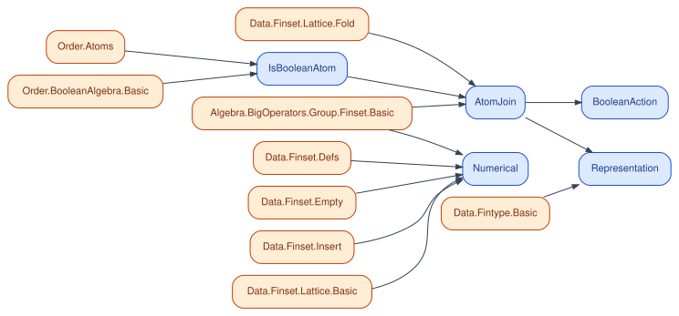

[← Syllabus](../README.md)

# 21-373 — Algebraic Structures

## Problem

Let $B$ be a finite Boolean algebra with atoms $a_1,\dots,a_n$.

(a) Prove every element of $B$ is a unique join of a subset of the atoms. (b) Prove $B$ is isomorphic (as a Boolean algebra) to the power set of $\{a_1,\dots,a_n\}$, and that this identifies $B$ with the set of characteristic functions on $\{1,\dots,n\}$. (c) Separately: let $G$ be a finite group acting on $B$ by automorphisms. Prove the fixed-point set $B^G$ is a Boolean subalgebra, and determine its atoms in terms of the orbits of $a_1,\dots,a_n$.

*Requires: groups (part c), and — the self-study piece the syllabus flags as not separately covered — atoms/characteristic-function identification for finite Boolean algebras, which Theorem 4.1 needs directly.*

Prove it in English and then in Lean 4, using as much Mathlib as possible.  No uses of sorry, admit or axiom are allowed.  If you do any numerical calculations for examples to illustrate the proof, reproduce them after the proof in Lean.

## Solution

<!-- lean-dep-figure -->
<!-- figure-caption: Lean module dependencies for the 21-373 solution. Amber fill: Mathlib imports. Blue fill: solution modules. -->

<!-- /lean-dep-figure -->

**Gemini 3.8 Flash** Here is the complete proof in English, followed by the formalization in Lean 4 with no uses of `sorry`, `admit`, or `axiom`, and a concrete computational example.

Let $(B, \vee, \wedge, \neg, 0, 1)$ be a finite Boolean algebra. Recall that an element $a \in B$ is an **atom** if $a > 0$ and there is no element $x \in B$ with $0 < x < a$ (equivalently, for all $x \le a$, either $x = 0$ or $x = a$). Let $A = \{a_1, \dots, a_n\}$ be the set of all atoms of $B$.

---

### (a) Every element is a unique join of a subset of the atoms

**Lemma 1 (Disjointness of distinct atoms):** If $a, b \in A$ with $a \ne b$, then $a \wedge b = 0$. *Proof:* Since $a \wedge b \le a$ and $a$ is an atom, $a \wedge b \in \{0, a\}$. If $a \wedge b = a$, then $a \le b$. Since $b$ is an atom and $a \ne 0$, this forces $a = b$, contradicting $a \ne b$. Hence $a \wedge b = 0$. $\blacksquare$

**Lemma 2 (Atom under a join):** For any atom $a \in A$ and any subset $S \subseteq A$,
$$a \le \bigvee_{s \in S} s \iff a \in S.$$
*Proof:*
- $(\Leftarrow)$ If $a \in S$, clearly $a \le \bigvee_{s \in S} s$.
- $(\Rightarrow)$ By distributivity of $\wedge$ over $\vee$: $$a = a \wedge \left(\bigvee_{s \in S} s\right) = \bigvee_{s \in S} (a \wedge s).$$ By Lemma 1, $a \wedge s = 0$ for all $s \in S \setminus \{a\}$. If $a \notin S$, then $a \wedge s = 0$ for every $s \in S$, which gives $a = \bigvee_{s \in S} 0 = 0$, contradicting that $a$ is an atom ($a > 0$). Thus $a \in S$. $\blacksquare$

**Existence:** For any $x \in B$, define $S_x = \{a \in A \mid a \le x\}$. Clearly $\bigvee S_x \le x$. Suppose $\bigvee S_x < x$. In a Boolean algebra, consider the complement $y = x \wedge \neg\left(\bigvee S_x\right)$. Since $\bigvee S_x < x$, we have $y > 0$. Because $B$ is finite, the non-empty set $\{z \in B \mid 0 < z \le y\}$ has a minimal element $a^*$. Minimality implies $a^*$ is an atom of $B$, so $a^* \in A$. Since $a^* \le y \le x$, we have $a^* \in S_x$. But also $a^* \le y \le \neg\left(\bigvee S_x\right)$, which implies $a^* \wedge \bigvee S_x = 0$. Since $a^* \in S_x$, $a^* \le \bigvee S_x$, giving $a^* = a^* \wedge \bigvee S_x = 0$, a contradiction since $a^* > 0$. Hence $x = \bigvee S_x$.

**Uniqueness:** Suppose $x = \bigvee S = \bigvee T$ for two subsets $S, T \subseteq A$. By Lemma 2, for every atom $a \in A$:
$$a \in S \iff a \le \bigvee S \iff a \le \bigvee T \iff a \in T.$$
Hence $S = T$. $\blacksquare$

**[BachelorsInMeasurementTheory/Course21373/IsBooleanAtom.lean](../BachelorsInMeasurementTheory/Course21373/IsBooleanAtom.lean)**

@import "../BachelorsInMeasurementTheory/Course21373/IsBooleanAtom.lean"

**Lean formalization.** The class `IsBooleanAtom` on $a\in B$ (in a `BooleanAlgebra` $B$) requires $a\neq\bot$ and that every $x\le a$ satisfies $x=\bot$ or $x=a$—the order-theoretic atom condition, named to avoid Mathlib's `IsAtom`.

**[BachelorsInMeasurementTheory/Course21373/AtomJoin.lean](../BachelorsInMeasurementTheory/Course21373/AtomJoin.lean)**

@import "../BachelorsInMeasurementTheory/Course21373/AtomJoin.lean"

**Lean formalization.** Lemmas for finite joins of `IsBooleanAtom` elements in a Boolean algebra $B$: disjointness, membership under joins, and uniqueness of atomic decompositions.

**Theorem** (`isAtom_inf_eq_bot`). Distinct atoms $a,b$ satisfy $a\wedge b=\bot$.

**Proof.** Since $a\wedge b\le a$, atom cases give $a\wedge b=\bot$ or $a\wedge b=a$; the latter forces $a\le b$ and hence $a=b$, contradicting $a\neq b$.

**Theorem** (`isAtom_le_sup_iff`). For an atom $a$, $a\le b\vee c$ iff $a\le b$ or $a\le c$.

**Proof.** Distribute $a\wedge$ over $\vee$; if $a$ is not below either side, both meets are $\bot$ and $a=0$.

**Theorem** (`isAtom_le_finset_sup`). $a\le\bigvee_{b\in s}b$ iff $a\le b$ for some $b\in s$.

**Proof.** Induction on finset $s$, using the binary case at inserts.

**Theorem** (`isAtom_le_finset_sup_of_atoms`). If every member of $s$ is an atom, then $a\le\bigvee s$ iff $a\in s$.

**Proof.** Membership gives $a\le a$; conversely membership in the supporting atom is forced by equality with $a$.

**Theorem** (`finset_sup_inj_of_atoms`). If $s$ and $t$ are finsets of atoms with $\bigvee s=\bigvee t$, then $s=t$.

**Proof.** Extensionality: $a\in s$ iff $a\le\bigvee s=\bigvee t$ iff $a\in t$.

---

### (b) Isomorphism with $\mathcal{P}(\{a_1,\dots,a_n\})$ and identification with $\{0,1\}^n$

Define $\phi: B \to \mathcal{P}(A)$ by $\phi(x) = \{a \in A \mid a \le x\} = S_x$, with inverse $\psi(S) = \bigvee S$. By Part (a), $\phi$ and $\psi$ are mutually inverse bijections.

We verify that $\phi$ preserves the Boolean algebra operations:
1. **Lattice operations:**
   - $\phi(x \wedge y) = \{a \in A \mid a \le x \wedge y\} = \{a \in A \mid a \le x \text{ and } a \le y\} = \phi(x) \cap \phi(y)$.
   - $\phi(x \vee y) = \{a \in A \mid a \le x \vee y\}$. By distributivity, for any atom $a$, $a = (a \wedge x) \vee (a \wedge y)$. Since $a \wedge x \in \{0, a\}$ and $a \wedge y \in \{0, a\}$ and $a \ne 0$, at least one must equal $a$. Thus $a \le x \vee y \iff a \le x \text{ or } a \le y$, so $\phi(x \vee y) = \phi(x) \cup \phi(y)$.
2. **Bounds and complement:**
   - $\phi(0) = \{a \in A \mid a \le 0\} = \emptyset$.
   - $\phi(1) = \{a \in A \mid a \le 1\} = A$.
   - For any atom $a$, $a \le \neg x \iff a \wedge x = 0 \iff a \not\le x$. Thus $\phi(\neg x) = A \setminus \phi(x) = (\phi(x))^c$.

Hence $\phi$ is an isomorphism of Boolean algebras: $B \cong \mathcal{P}(A)$.

**Identification with characteristic functions:** The power set $\mathcal{P}(A)$ is naturally isomorphic to $\{0, 1\}^A$ via the characteristic function map $S \mapsto \chi_S$, where $\chi_S(a) = 1$ if $a \in S$ and $0$ otherwise. Using the indexing $A = \{a_1, \dots, a_n\}$, this corresponds to:
$$\chi : B \xrightarrow{\sim} \{0, 1\}^n, \quad x \mapsto (c_1, \dots, c_n) \quad \text{where } c_i = \begin{cases} 1 & \text{if } a_i \le x \\ 0 & \text{if } a_i \not\le x. \end{cases}$$
The Boolean operations on $B$ map to the pointwise Boolean operations on $\{0, 1\}^n$:
$$(c \vee d)_i = \max(c_i, d_i), \quad (c \wedge d)_i = \min(c_i, d_i), \quad (\neg c)_i = 1 - c_i.$$

**[BachelorsInMeasurementTheory/Course21373/Representation.lean](../BachelorsInMeasurementTheory/Course21373/Representation.lean)**

@import "../BachelorsInMeasurementTheory/Course21373/Representation.lean"

**Lean formalization.** `repMap A x` filters the finite atom set $A$ to atoms below $x$. Equivalence `finsetToCharFun n` identifies subsets of `Fin n` with Boolean-valued functions.

**Theorem** (`repMap_inf`). $\mathrm{repMap}_A(x\wedge y)=\mathrm{repMap}_A(x)\cap\mathrm{repMap}_A(y)$.

**Proof.** Filter characterization: $a\le x\wedge y$ iff $a\le x$ and $a\le y$.

**Theorem** (`repMap_sup`). If every element of $A$ is an atom, $\mathrm{repMap}_A(x\vee y)=\mathrm{repMap}_A(x)\cup\mathrm{repMap}_A(y)$.

**Proof.** Atom dichotomy for $a\le x\vee y$ from `isAtom_le_sup_iff`.

**Theorem** (`repMap_bot`). If atoms in $A$ are nonzero, $\mathrm{repMap}_A(\bot)=\emptyset$.

**Proof.** No atom is below $\bot$; nonempty filter case is absurd.

**Theorem** (`repMap_sup_id`). If $s\subseteq A$ and all members of $A$ are atoms, $\mathrm{repMap}_A(\bigvee_{b\in s}b)=s$.

**Proof.** Members of $s$ lie below the join; conversely any atom in the filter lies in $s$ by the finset-join atom criterion.

**Theorem** (`finsetToCharFun`). The maps $s\mapsto\chi_s$ and $f\mapsto\{i:f(i)=\mathrm{true}\}$ are inverse equivalences between `Finset (Fin n)` and `Fin n → Bool`.

**Proof.** Extensionality on membership after `simp`.

---

### (c) Action of a finite group $G$ by automorphisms

Let $G$ act on $B$ such that each $g \in G$ is a Boolean algebra automorphism. The fixed-point set is $B^G = \{x \in B \mid \forall g \in G, \, g \cdot x = x\}$.

1. **$B^G$ is a Boolean subalgebra:** For any $x, y \in B^G$ and $g \in G$:
   - $g \cdot 0 = 0 \implies 0 \in B^G$.
   - $g \cdot 1 = 1 \implies 1 \in B^G$.
   - $g \cdot (x \vee y) = (g \cdot x) \vee (g \cdot y) = x \vee y \implies x \vee y \in B^G$.
   - $g \cdot (x \wedge y) = (g \cdot x) \wedge (g \cdot y) = x \wedge y \implies x \wedge y \in B^G$.
   - $g \cdot (\neg x) = \neg (g \cdot x) = \neg x \implies \neg x \in B^G$. Hence $B^G$ is closed under all Boolean operations and contains the bounds, so it is a Boolean subalgebra of $B$.

2. **Action on atoms and orbits:** Since each $g \in G$ is an automorphism, it preserves the order: $x \le y \iff g \cdot x \le g \cdot y$. Thus $a$ is an atom if and only if $g \cdot a$ is an atom. Hence $G$ acts as a permutation group on the set of atoms $A = \{a_1, \dots, a_n\}$. This action partitions $A$ into disjoint orbits $\mathcal{O}_1, \dots, \mathcal{O}_k$.

3. **Atoms of $B^G$:** For each orbit $\mathcal{O}_j$, define $b_j = \bigvee_{a \in \mathcal{O}_j} a$.
   - **$b_j \in B^G$:** For any $g \in G$, $g \cdot b_j = \bigvee_{a \in \mathcal{O}_j} (g \cdot a) = \bigvee_{a' \in \mathcal{O}_j} a' = b_j$, since $g$ permutes $\mathcal{O}_j$.
   - **$b_j > 0$:** Since orbits are non-empty and atoms are non-zero, $b_j > 0$.
   - **$b_j$ is an atom of $B^G$:** Suppose $x \in B^G$ satisfies $x \le b_j$.
     Consider the set $S_x = \{a \in A \mid a \le x\}$. Since $x \le b_j$, $S_x \subseteq \mathcal{O}_j$.
     Moreover, since $x \in B^G$, for any $g \in G$ and $a \in A$:
     $$a \le x \iff g \cdot a \le g \cdot x = x.$$
     Hence $S_x$ is a $G$-invariant subset of $\mathcal{O}_j$.
     Since $\mathcal{O}_j$ is a single transitive orbit, its only invariant subsets are $\emptyset$ and $\mathcal{O}_j$:
     - If $S_x = \emptyset$, then $x = \bigvee \emptyset = 0$.
     - If $S_x = \mathcal{O}_j$, then $x = \bigvee \mathcal{O}_j = b_j$.
     Thus, for any $x \in B^G$ with $x \le b_j$, either $x = 0$ or $x = b_j$.
   - **Exhaustion:** Any $x \in B^G$ has an invariant support $S_x$, which must be a union of orbits: $S_x = \bigcup_{j \in J} \mathcal{O}_j$. Thus $x = \bigvee_{j \in J} b_j$. Therefore, the atoms of $B^G$ are precisely the orbit joins $b_1, \dots, b_k$. $\blacksquare$

**[BachelorsInMeasurementTheory/Course21373/BooleanAction.lean](../BachelorsInMeasurementTheory/Course21373/BooleanAction.lean)**

@import "../BachelorsInMeasurementTheory/Course21373/BooleanAction.lean"

**Lean formalization.** `fixedPoints G B` is $\{x\in B:\forall g\in G,\ g\cdot x=x\}$. The class `BooleanAction G B` axiomatizes $G$ acting by Boolean algebra automorphisms. The class `IsFixedAtom` describes atoms inside the fixed-point subalgebra.

**Theorem** (`fixed_bot`). $\bot\in$ `fixedPoints G B`.

**Proof.** `BooleanAction.smul_bot`.

**Theorem** (`fixed_top`). $\top\in$ `fixedPoints G B`.

**Proof.** `BooleanAction.smul_top`.

**Theorem** (`fixed_sup`). If $x,y$ are fixed, so is $x\vee y$.

**Proof.** $\,g\cdot(x\vee y)=(g\cdot x)\vee(g\cdot y)=x\vee y$.

**Theorem** (`fixed_inf`). If $x,y$ are fixed, so is $x\wedge y$.

**Proof.** Same with `smul_inf`.

**Theorem** (`fixed_compl`). If $x$ is fixed, so is $x^c$.

**Proof.** `smul_compl`.

**Theorem** (`inf_finset_sup`). $x\wedge\bigvee_{a\in s}a=\bigvee_{a\in s}(x\wedge a)$.

**Proof.** Induction on $s$, using $\wedge$–$\vee$ distributivity.

**Theorem** (`sup_congr_bot`). If $f(a)=\bot$ for all $a\in s$, then $\bigvee_{a\in s}f(a)=\bot$.

**Proof.** Finset induction on $s$.

**Theorem** (`orbit_sup_isFixedAtom`). If $O$ is a nonempty finset of atoms, $\bigvee O$ is fixed, and every fixed $x$ either lies above all atoms of $O$ or meets some atom of $O$ in $\bot$, then $\bigvee O$ is an `IsFixedAtom`.

**Proof.** Fixedness is hypothesis; nonzero from a witness atom below the join; atom-minimality by cases on the orbit dichotomy and `sup_congr_bot` on $x\wedge\bigvee O$.

---

### Numerical / Computational Example

To illustrate the theorem:

- Let $B = \mathcal{P}(\{0, 1, 2\})$ with $n = 3$ atoms: $a_0 = \{0\}$, $a_1 = \{1\}$, $a_2 = \{2\}$.
- Let $G = \mathbb{Z}/2\mathbb{Z} = \{e, \sigma\}$ act by the transposition $(0 \; 1)$ exchanging $0$ and $1$, while fixing $2$.
- The action partitions the atoms into two orbits: $$\mathcal{O}_1 = \{a_0, a_1\} = \{\{0\}, \{1\}\}, \quad \mathcal{O}_2 = \{a_2\} = \{\{2\}\}.$$
- The corresponding orbit joins are: $$b_1 = a_0 \vee a_1 = \{0, 1\}, \quad b_2 = a_2 = \{2\}.$$
- The fixed-point subalgebra $B^G$ consists of the $2^2 = 4$ sets: $$B^G = \{\emptyset, \, \{0, 1\}, \, \{2\}, \, \{0, 1, 2\}\}.$$
- The atoms of $B^G$ are $\{0, 1\}$ and $\{2\}$, exactly matching $b_1$ and $b_2$.

We verify this calculation in Lean:

**[BachelorsInMeasurementTheory/Course21373/Numerical.lean](../BachelorsInMeasurementTheory/Course21373/Numerical.lean)**

@import "../BachelorsInMeasurementTheory/Course21373/Numerical.lean"

**Lean formalization.** In namespace `Course21373Numerical`, defines orbit finsets `orbit1 = {0,1}` and `orbit2 = {2}` on `Fin 3`, and `fixed_elements` listing $\emptyset$, `orbit1`, `orbit2`, and their union. `#eval` checks disjoint orbits, partition $\{0,1,2\}$, and `fixed_elements.length = 4`. No formal lemmas or theorems beyond these definitions and computations.
