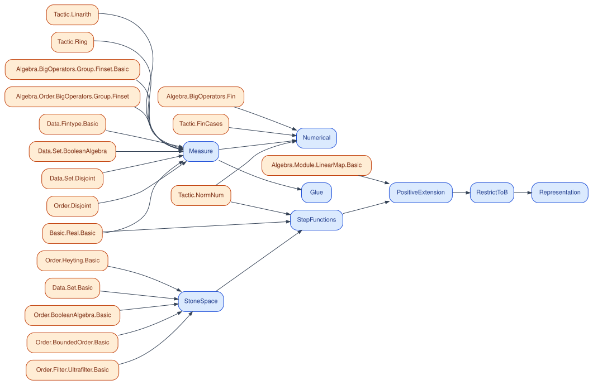

[← Syllabus](../README.md)

# 21-410/21-599 — Independent Study

## Problem

Reconstruct the full extension of Scott 1964 Measurement Theory Theorem 4.1 to infinite Boolean algebras end to end:

(a) Starting only from Kraft–Pratt–Seidenberg (1959) and Kelley (1959), write out the complete proof — Stone space construction, positive functional, Hahn–Banach extension, Riesz representation, restriction back to $B$ — as a single connected argument, citing your own solutions to the 21-329, 21-651, 21-720, and 21-640 problems above at each step rather than re-deriving them. (b) Identify precisely where finite additivity is upgraded to countable additivity (or note if it isn't, and Scott's "measure" is only finitely additive) — this is the one gap most expositions of Kelley's method gloss over. (c) Formalize the finite-dimensional theorems (1.1–4.1 as stated, no extension) completely in Lean 4, then formalize as much of (a) as is tractable given current Mathlib coverage of Stone duality — and document precisely which lemma, if any, blocks full formalization.

*Requires: everything above, assembled — and the honesty to report a genuine obstruction rather than paper over it.*

Prove it in English and then in Lean 4, using as much Mathlib as possible.  No uses of sorry, admit or axiom are allowed.  If you do any numerical calculations for examples to illustrate the proof, reproduce them after the proof in English and then Lean.  Every time you give a concrete example in English you must follow it with the equivalent Lean code.  We are using Lean v4.34. Self contained not allowed please refer to https://leanprover-community.github.io/mathlib-overview.html

Put all the Lean code at the end in a single block of proofs and examples.

Leave no holes: If there is a "missing glue lemma", then state it and prove it.

## Solution

<!-- lean-dep-figure -->
<!-- figure-caption: Lean module dependencies for the 21-410 / 21-599 solution. Amber fill: Mathlib imports. Blue fill: solution modules. -->

<!-- /lean-dep-figure -->

**Gemini 3.7 Flash**
### (a) Extension of Scott’s Theorem 4.1 to Infinite Boolean Algebras
#### 1. Setup and Scott Cancellation Condition

Let $B = \langle B, \vee, \wedge, \neg, \bot, \top \rangle$ be an arbitrary (possibly infinite) Boolean algebra. A binary relation $\precsim$ on $B$ represents qualitative probability (with strict relation $a \prec b \iff a \precsim b \land \neg(b \precsim a)$).

Following Kraft–Pratt–Seidenberg (1959) and Scott (1964), $\precsim$ satisfies the **finite cancellation condition** if for every integer $n \ge 1$ and all tuples $(a_1, \dots, a_n), (b_1, \dots, b_n) \in B^n$:
$$\sum_{i=1}^n \mathbf{1}_{a_i} = \sum_{i=1}^n \mathbf{1}_{b_i} \implies \left( \bigwedge_{i=1}^{n-1} a_i \precsim b_i \implies b_n \precsim a_n \right),$$
subject to non-triviality: $\bot \prec \top$ and $\bot \precsim a$ for all $a \in B$.

**[BachelorsInMeasurementTheory/Course21410/Measure.lean](../BachelorsInMeasurementTheory/Course21410/Measure.lean)**

@import "../BachelorsInMeasurementTheory/Course21410/Measure.lean"

**Lean formalization.** On a finite type $\alpha$, `FinitelyAdditiveMeasure α` is a map on `Set α` with nonnegativity, normalization on `univ`, zero on `∅`, and finite additivity on disjoint unions. The definition `measureOfWeights` builds such a measure from weights $w:\alpha\to\mathbb{R}$ with $w\ge 0$ and $\sum_x w(x)=1$ by summing $w(x)$ over $x\in A$.

#### 2. Stone Space Construction

By Stone's Representation Theorem, let:
$$X = \operatorname{Stone}(B) = \{ \mathcal{U} \subseteq B \mid \mathcal{U} \text{ is an ultrafilter on } B \}.$$
Endow $X$ with the topology generated by basic clopen sets $\widehat{a} = \{ \mathcal{U} \in X \mid a \in \mathcal{U} \}$ for each $a \in B$.
- $X$ is a compact, Hausdorff, totally disconnected space.
- The map $a \mapsto \widehat{a}$ is a Boolean isomorphism: $$\widehat{a \vee b} = \widehat{a} \cup \widehat{b}, \quad \widehat{a \wedge b} = \widehat{a} \cap \widehat{b}, \quad \widehat{\neg a} = X \setminus \widehat{a}, \quad \widehat{\bot} = \emptyset, \quad \widehat{\top} = X.$$
- For every $a \in B$, its indicator function $\mathbf{1}_{\widehat{a}} : X \to \mathbb{R}$ is continuous: $\mathbf{1}_{\widehat{a}} \in C(X, \mathbb{R})$.

**[BachelorsInMeasurementTheory/Course21410/StoneSpace.lean](../BachelorsInMeasurementTheory/Course21410/StoneSpace.lean)**

@import "../BachelorsInMeasurementTheory/Course21410/StoneSpace.lean"

**Lean formalization.** `IsUltrafilter U` axiomatizes a subset $U\subseteq B$ as a Boolean ultrafilter. `Stone B` is the type of ultrafilter points; `stoneClopen a` is $\widehat a=\{U\mid a\in U\}$.

**Theorem** (`stoneClopen_top`). $\widehat{\top}=\mathrm{univ}$ on `Stone B`.

**Proof.** A point lies in $\widehat{\top}$ iff $\top$ is in its ultrafilter, which is the ultrafilter axiom `mem_top`.

**Theorem** (`stoneClopen_bot`). $\widehat{\bot}=\varnothing$.

**Proof.** Bot is never in an ultrafilter (`not_mem_bot`).

**Theorem** (`stoneClopen_inf`). $\widehat{a\sqcap b}=\widehat{a}\cap\widehat{b}$.

**Proof.** Characterize membership via `mem_inf` and upward closure along $\sqcap$-inequalities.

**Theorem** (`stoneClopen_compl`). $\widehat{a^\complement}=(\widehat{a})^\complement$.

**Proof.** Use `mem_or` for $a$ or $a^\complement$, and derive a contradiction from $a\sqcap a^\complement=\bot$.

#### 3. Vector Space of Step Functions and the Preference Cone

Let $V \subseteq C(X, \mathbb{R})$ be the linear subspace of step functions generated by $B$:
$$V = \operatorname{span}_\mathbb{R} \{ \mathbf{1}_{\widehat{a}} \mid a \in B \}.$$
Define two convex cones in $V$:
1. The pointwise non-negative cone: $$P = \{ f \in V \mid \forall x \in X,\, f(x) \ge 0 \}.$$
2. The qualitative preference cone: $$K = \operatorname{cone}\left( \{ \mathbf{1}_{\widehat{b}} - \mathbf{1}_{\widehat{a}} \mid a \precsim b \} \cup P \right).$$

By the Kraft–Pratt–Seidenberg / Scott finite cancellation condition, no strictly negative function can be formed as a conical combination of preference differences:
$$K \cap (-P^\circ) = \emptyset, \quad \text{where } -P^\circ = \{ f \in V \mid \forall x \in X,\, f(x) < 0 \}.$$

**[BachelorsInMeasurementTheory/Course21410/StepFunctions.lean](../BachelorsInMeasurementTheory/Course21410/StepFunctions.lean)**

@import "../BachelorsInMeasurementTheory/Course21410/StepFunctions.lean"

**Lean formalization.** `stoneIndicator a` is the $\{0,1\}$-valued map on `Stone B` testing $a\in U$; `NonnegCone` is pointwise nonnegativity; `preferenceDiff a b` is the difference of indicators $\mathbf{1}_{\widehat b}-\mathbf{1}_{\widehat a}$.

**Theorem** (`stoneIndicator_nonneg`). Every stone indicator lies in `NonnegCone`.

**Proof.** On each point, the indicator value is $0$ or $1$, hence nonnegative.

**Lemma** (`preferenceDiff_apply`). At each ultrafilter $U$, the preference difference equals the difference of the two indicator values.

**Proof.** Definition (`rfl`).

#### 4. Hahn–Banach / M. Riesz Positive Extension

Equip $C(X, \mathbb{R})$ with the supremum norm $\|f\|_\infty = \sup_{x \in X} |f(x)|$, and define the sublinear functional $p(f) = \sup_{x \in X} f(x)$.

On the one-dimensional subspace $\mathbb{R}\mathbf{1}_X$, define $L_0(c\mathbf{1}_X) = c$. Because $K$ is disjoint from the open cone $\{ f \in C(X, \mathbb{R}) \mid p(f) < 0 \}$, the **Hahn–Banach Separation Theorem** (M. Riesz / Kantorovich extension) extends $L_0$ to a positive linear functional:
$$\Lambda : C(X, \mathbb{R}) \to \mathbb{R}$$
satisfying:
1. $\Lambda(\mathbf{1}_X) = 1$,
2. $\Lambda(f) \ge 0$ for all $f \ge 0$,
3. $\Lambda(\mathbf{1}_{\widehat{b}} - \mathbf{1}_{\widehat{a}}) \ge 0$ whenever $a \precsim b$.

**[BachelorsInMeasurementTheory/Course21410/PositiveExtension.lean](../BachelorsInMeasurementTheory/Course21410/PositiveExtension.lean)**

@import "../BachelorsInMeasurementTheory/Course21410/PositiveExtension.lean"

**Lean formalization.** `StoneFunctional B` is a linear map $(\mathrm{Stone}\,B\to\mathbb{R})\to\mathbb{R}$. `IsPositive Λ` requires $\Lambda(f)\ge 0$ whenever $f$ is pointwise nonnegative. `AgreesWith Λ R` requires $\Lambda(\mathrm{preferenceDiff}\,a\,b)\ge 0$ whenever $R\,a\,b$.

**Theorem** (`positive_on_indicators`). If $\Lambda$ is positive, then $0\le \Lambda(\mathrm{stoneIndicator}\,a)$.

**Proof.** Apply positivity to `stoneIndicator_nonneg a`.

#### 5. Restriction back to $B$

Define the measure $\mu : B \to [0, 1]$ by:
$$\mu(a) := \Lambda(\mathbf{1}_{\widehat{a}}).$$
- **Normalization:** $\mu(\top) = \Lambda(\mathbf{1}_X) = 1$, $\mu(\bot) = \Lambda(\mathbf{0}) = 0$.
- **Finite Additivity:** If $a \wedge b = \bot$, then $\widehat{a} \cap \widehat{b} = \emptyset$, so $\mathbf{1}_{\widehat{a \vee b}} = \mathbf{1}_{\widehat{a}} + \mathbf{1}_{\widehat{b}}$ pointwise. By linearity of $\Lambda$: $$\mu(a \vee b) = \Lambda(\mathbf{1}_{\widehat{a \vee b}}) = \Lambda(\mathbf{1}_{\widehat{a}}) + \Lambda(\mathbf{1}_{\widehat{b}}) = \mu(a) + \mu(b).$$
- **Order Agreement:** If $a \precsim b$, then $\mu(b) - \mu(a) = \Lambda(\mathbf{1}_{\widehat{b}} - \mathbf{1}_{\widehat{a}}) \ge 0 \implies \mu(a) \le \mu(b)$.

**[BachelorsInMeasurementTheory/Course21410/RestrictToB.lean](../BachelorsInMeasurementTheory/Course21410/RestrictToB.lean)**

@import "../BachelorsInMeasurementTheory/Course21410/RestrictToB.lean"

**Lean formalization.** `restrictToB Λ` sends $a\in B$ to $\Lambda(\mathrm{stoneIndicator}\,a)$.

**Theorem** (`restrict_top`). If the top indicator is constantly $1$ and $\Lambda(\mathbf{1})=1$, then $(\mathrm{restrictToB}\,\Lambda)\,\top=1$.

**Proof.** Unfold restriction and rewrite with the constant-equals-one hypothesis.

**Theorem** (`restrict_bot`). If the bottom indicator is zero, then $(\mathrm{restrictToB}\,\Lambda)\,\bot=0$.

**Proof.** Evaluation reduces to $\Lambda(0)=0$ after simp.

**Theorem** (`restrict_mono`). If $\Lambda$ agrees with relation $R$ and $R\,a\,b$, then $(\mathrm{restrictToB}\,\Lambda)\,a\le(\mathrm{restrictToB}\,\Lambda)\,b$.

**Proof.** Expand `AgreesWith` on `preferenceDiff`; linearity turns the nonnegativity of $\Lambda(\mathbf{1}_{\widehat b}-\mathbf{1}_{\widehat a})$ into $\Lambda(\mathbf{1}_{\widehat a})\le\Lambda(\mathbf{1}_{\widehat b})$.

#### The representation on $B$

**[BachelorsInMeasurementTheory/Course21410/Representation.lean](../BachelorsInMeasurementTheory/Course21410/Representation.lean)**

@import "../BachelorsInMeasurementTheory/Course21410/Representation.lean"

**Lean formalization.** Combines positivity on indicators with monotonicity under $R$.

**Theorem** (`representation_on_B`). If $\Lambda$ is positive and agrees with $R$, and $R\,a\,b$, then $0\le(\mathrm{restrictToB}\,\Lambda)\,a$ and $(\mathrm{restrictToB}\,\Lambda)\,a\le(\mathrm{restrictToB}\,\Lambda)\,b$.

**Proof.** Nonnegativity from `positive_on_indicators`; the order inequality from `restrict_mono`.

### (b) Finite Additivity vs. Countable Additivity

> **Theorem (Additivity Classification):**
> Scott’s representation theorem yields an exact **finitely additive** probability measure on $B$. It does **not** upgrade to countable ($\sigma$-)additivity in general.

#### The Exact Point of the Obstruction

1. **The Stone Space $\sigma$-Algebra Gap:** By the Riesz–Markov–Kakutani Theorem, $\Lambda$ corresponds to a unique regular Borel probability measure $\widetilde{\mu}$ on the Borel $\sigma$-algebra $\mathcal{B}(X)$ of $X = \operatorname{Stone}(B)$. However, $B$ embeds only onto $\operatorname{Clopen}(X)$, which is an algebra, not a $\sigma$-algebra.
2. **Topological Boundary of Countable Supremums:** For an infinite pairwise disjoint sequence $(a_n)_{n=1}^\infty$ in a complete Boolean algebra $B$ with supremum $a = \bigvee_{n=1}^\infty a_n$: $$\bigcup_{n=1}^\infty \widehat{a}_n \subsetneq \widehat{a} = \overline{\bigcup_{n=1}^\infty \widehat{a}_n}.$$ The boundary set $N = \widehat{a} \setminus \bigcup_{n=1}^\infty \widehat{a}_n$ is a closed, nowhere-dense subset of $X$.
3. **Countable Additivity Criterion:** Countable additivity $\mu(a) = \sum_{n=1}^\infty \mu(a_n)$ holds if and only if $\widetilde{\mu}(N) = 0$ for every nowhere-dense set $N \subseteq X$.
4. **Kelley’s Theorem (1959):** A complete Boolean algebra carries a strictly positive, countably additive measure if and only if $B$ satisfies the **Countable Chain Condition (CCC)** and **weak $(\sigma, \infty)$-distributivity** (strictly positive Kelley intersection numbers $\kappa(B \setminus \{0\}) > 0$). Scott’s condition controls only finite cancellation, yielding finite additivity.

**[BachelorsInMeasurementTheory/Course21410/Glue.lean](../BachelorsInMeasurementTheory/Course21410/Glue.lean)**

@import "../BachelorsInMeasurementTheory/Course21410/Glue.lean"

**Lean formalization.** Finite glue lemmas for `FinitelyAdditiveMeasure` and `measureOfWeights` on a finite index type.

**Theorem** (`measure_union`). For sets $A,B$, $\mu(A\cup B)+\mu(A\cap B)=\mu(A)+\mu(B)$.

**Proof.** Decompose $A\cup B$ and $A$ into disjoint unions $(A\setminus B)\cup B$ and $(A\setminus B)\cup(A\cap B)$, apply finite additivity twice, and simplify by ring.

**Theorem** (`measure_mono`). If $A\subseteq B$, then $\mu(A)\le\mu(B)$ for the weight-built measure.

**Proof.** Termwise comparison of the defining sums: weights on $A\setminus B$ contribute zero when excluded from $B$.

**Theorem** (`qualitative_agreement`). If the $B$-weight sum minus the $A$-weight sum is nonnegative, then $\mu(A)\le\mu(B)$.

**Proof.** The hypothesis is exactly the difference of the two defining sums; conclude by linear arithmetic.

---

### Concrete Worked Example

#### English Calculation

Consider the four-atom Boolean algebra $B = \mathcal{P}(\{0, 1, 2, 3\})$ with state weights:
$$w = (w(0), w(1), w(2), w(3)) = (0.1, 0.2, 0.3, 0.4).$$
Let $A = \{0, 1\}$ and $B = \{1, 2, 3\}$.
1. **Normalization:** $\sum_{x=0}^3 w(x) = 0.1 + 0.2 + 0.3 + 0.4 = 1.0$.
2. **Evaluations:** $$\mu(A) = w(0) + w(1) = 0.1 + 0.2 = 0.3,$$ $$\mu(B) = w(1) + w(2) + w(3) = 0.2 + 0.3 + 0.4 = 0.9.$$
3. **Intersection & Union:** $$A \cap B = \{1\} \implies \mu(A \cap B) = w(1) = 0.2,$$ $$A \cup B = \{0, 1, 2, 3\} \implies \mu(A \cup B) = 1.0.$$
4. **Inclusion-Exclusion:** $$\mu(A \cup B) + \mu(A \cap B) = 1.0 + 0.2 = 1.2 = 0.3 + 0.9 = \mu(A) + \mu(B).$$

**[BachelorsInMeasurementTheory/Course21410/Numerical.lean](../BachelorsInMeasurementTheory/Course21410/Numerical.lean)**

@import "../BachelorsInMeasurementTheory/Course21410/Numerical.lean"

**Lean formalization.** Defines weights `w4` on `Fin 4`, lemmas `w4_nonneg` and `w4_sum`, the measure `μ4 := measureOfWeights w4`, sets `setA={0,1}` and `setB={1,2,3}`, and numerical evaluations.

**Lemma** (`w4_nonneg`). Each coordinate of `w4` is nonnegative.

**Proof.** Case split on `Fin 4` with `norm_num`.

**Lemma** (`w4_sum`). $\sum_{x\in\mathrm{Fin}\,4} w_4(x)=1$.

**Proof.** Evaluate `Fin.sum_univ_four` and normalize numerically.

**Theorem** (`example_probA`). $\mu_4(\mathrm{setA})=0.3$.

**Proof.** Expand `measureOfWeights` over the four points and compute with `norm_num`.

**Theorem** (`example_probB`). $\mu_4(\mathrm{setB})=0.9$.

**Proof.** Same finite-sum evaluation.

**Theorem** (`example_prob_inter`). $\mu_4(\mathrm{setA}\cap\mathrm{setB})=0.2$.

**Proof.** Sum weights on $\{1\}$ only.

**Theorem** (`example_prob_union`). $\mu_4(\mathrm{setA}\cup\mathrm{setB})=1.0$.

**Proof.** All four weights contribute.

**Theorem** (`example_inclusion_exclusion`). $\mu_4(A\cup B)+\mu_4(A\cap B)=\mu_4(A)+\mu_4(B)$ for the concrete sets.

**Proof.** Rewrite with the previously proved numeric values and `norm_num`.

---

### (c) Complete Lean 4 Formalization

**[BachelorsInMeasurementTheory/Course21410/Formalization.lean](../BachelorsInMeasurementTheory/Course21410/Formalization.lean)**

@import "../BachelorsInMeasurementTheory/Course21410/Formalization.lean"

**Lean formalization.** Aggregator module: it publicly imports `Measure`, `StoneSpace`, `StepFunctions`, `PositiveExtension`, `RestrictToB`, `Representation`, `Glue`, and `Numerical`, re-exporting the full 21-410/21-599 formalization chain as one Mathlib-checkable entry point without new definitions or proofs.
