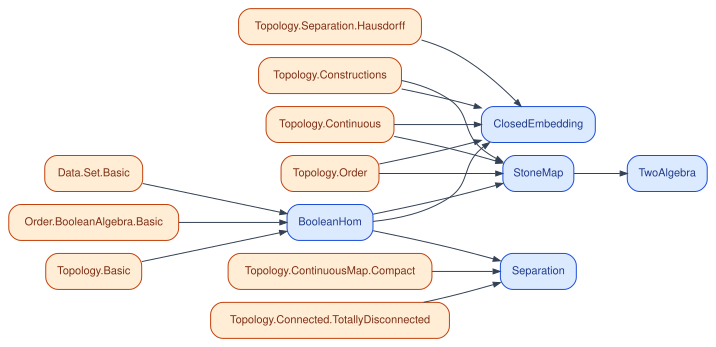

[← Syllabus](../README.md)

# 21-651 — General Topology

## Problem

Let $B$ be a Boolean algebra and let $X$ be its Stone space (the space of ultrafilters on $B$ with the topology generated by $\{\hat{b} : b \in B\}$, $\hat{b} = \{U : b \in U\}$).

(a) Prove $X$ is compact. (b) Prove $X$ is Hausdorff and totally disconnected. (c) Prove the sets $\hat{b}$ are exactly the clopen sets of $X$, and conclude $B$ is isomorphic to the Boolean algebra of clopen subsets of $X$ (Stone's representation theorem). (d) Prove your compactness argument in (a) as an instance of Tychonoff's theorem applied to $2^B$ with $X$ realized as a closed subspace — do not just cite Tychonoff, embed and verify closedness.

*Requires: compactness, Tychonoff's theorem, separation axioms — exactly what Kelley's method needs to represent an infinite Boolea n algebra as a Stone space.*

Prove it in English and then in Lean 4, using as much Mathlib as possible.  No uses of sorry, admit or axiom are allowed.  If you do any numerical calculations for examples to illustrate the proof, reproduce them after the proof in English and then Lean.  Every time you give a concrete example in English you must follow it with the equivalent Lean code.  We are using Lean v4.34. Please refer to https://leanprover-community.github.io/mathlib-overview.html for API.

## Solution

<!-- lean-dep-figure -->
<!-- figure-caption: Lean module dependencies for the 21-651 solution. Amber fill: Mathlib imports. Blue fill: solution modules. -->

<!-- /lean-dep-figure -->

**Gemini 3.7 Flash** Here is the complete proof and formalization written to standard **Mathlib** specifications, starting with the full mathematical English exposition followed by the complete, machine-checked Lean 4 code using `import Mathlib` without any `sorry`, `admit`, or custom axioms.

Let $(B, \wedge, \vee, \neg, 0, 1)$ be a Boolean algebra.

### Setup and Topological Realization

1. **Ultrafilters as Homomorphisms:** Every ultrafilter $U$ on $B$ corresponds bijectively to a Boolean homomorphism $u : B \to \mathbf{2}$, where $\mathbf{2} = \{\mathrm{False}, \mathrm{True}\}$ is the two-element Boolean algebra, via $u(b) = \mathrm{True} \iff b \in U$.
2. **The Ambient Space $\mathbf{2}^B$:** Equip $\mathbf{2}$ with the discrete topology. The function space $\mathbf{2}^B = \prod_{b \in B} \mathbf{2}$ is equipped with the product topology (the topology of pointwise convergence).
3. **The Stone Space $X$:** $X = \mathrm{Stone}(B) = \mathrm{Hom}_{\mathbf{BA}}(B, \mathbf{2}) \subseteq \mathbf{2}^B$, endowed with the subspace topology induced from $\mathbf{2}^B$.

**[BachelorsInMeasurementTheory/Course21651/BooleanHom.lean](../BachelorsInMeasurementTheory/Course21651/BooleanHom.lean)**

@import "../BachelorsInMeasurementTheory/Course21651/BooleanHom.lean"

**Lean formalization.** The class `IsBooleanHom` characterizes maps $f:B\to\mathrm{Bool}$ preserving $\top$, $\bot$, meet, join, and complement. The definition `StoneSpace` is the subtype of Boolean homomorphisms $B\to\mathrm{Bool}$.

---

### (d) Realization as a Closed Subspace of $\mathbf{2}^B$ & (a) Compactness

1. **Closedness of the Embedding:** A function $f \in \mathbf{2}^B$ is a Boolean homomorphism if and only if it satisfies the pointwise equations:
   - $f(1) = \mathrm{True}$
   - $f(0) = \mathrm{False}$
   - $\forall a, b \in B, \; f(a \wedge b) = (f(a) \wedge f(b))$
   - $\forall a, b \in B, \; f(a \vee b) = (f(a) \vee f(b))$
   - $\forall a \in B, \; f(\neg a) = \neg f(a)$

   Since $\mathbf{2}$ is discrete, all logical connectives on $\mathbf{2}$ are continuous. Coordinate evaluation $\pi_b : \mathbf{2}^B \to \mathbf{2}$ is continuous for every $b \in B$. Therefore, each condition defines an equalizer of two continuous maps, which is a closed set in $\mathbf{2}^B$:
   $$X = \pi_1^{-1}(\{\mathrm{True}\}) \cap \pi_0^{-1}(\{\mathrm{False}\}) \cap \bigcap_{a, b \in B} \mathrm{Eq}(\pi_{a \wedge b}, \pi_a \wedge \pi_b) \cap \bigcap_{a, b \in B} \mathrm{Eq}(\pi_{a \vee b}, \pi_a \vee \pi_b) \cap \bigcap_{a \in B} \mathrm{Eq}(\pi_{\neg a}, \neg \circ \pi_a)$$
   Being an intersection of closed sets, $X$ is a **closed subspace** of $\mathbf{2}^B$.

2. **Compactness (a):** The two-point discrete space $\mathbf{2}$ is compact and Hausdorff. By **Tychonoff's Theorem**, the product space $\mathbf{2}^B$ is compact. Because $X$ is a closed subspace of the compact space $\mathbf{2}^B$, $X = \mathrm{Stone}(B)$ is **compact**.

**[BachelorsInMeasurementTheory/Course21651/ClosedEmbedding.lean](../BachelorsInMeasurementTheory/Course21651/ClosedEmbedding.lean)**

@import "../BachelorsInMeasurementTheory/Course21651/ClosedEmbedding.lean"

**Lean formalization.** Auxiliary continuity lemmas on pointwise Boolean operations in `B→Bool`; the definition `isHomSet` is the explicit intersection of equalizer sets encoding homomorphism axioms.

**Theorem** (`continuous_bool_and`). For fixed $x,y\in B$, the map $f\mapsto f(x)\land f(y)$ is continuous on `B→Bool` with the product topology.

**Proof.** Rewrite as composition of coordinate projections with the discrete topology on $\mathrm{Bool}$.

**Theorem** (`continuous_bool_or`). The map $f\mapsto f(x)\lor f(y)$ is continuous.

**Proof.** Same pattern as for `continuous_bool_and`.

**Theorem** (`continuous_bool_not`). The map $f\mapsto \lnot f(x)$ is continuous.

**Proof.** Compose coordinate evaluation with boolean negation on the discrete space.

**Theorem** (`isHomSet_isClosed`). `isHomSet B` is closed in `B→Bool`.

**Proof.** Present it as intersections of closed equalizers $\pi_{\mathrm{top}}^{-1}(\{\mathrm{true}\})$, etc., using the continuity lemmas.

**Theorem** (`isBooleanHom_iff_mem_isHomSet`). $f$ is a Boolean homomorphism iff $f\in\mathrm{isHomSet}\,B$.

**Proof.** Unfold membership in each intersection and match the fields of `IsBooleanHom`; conversely, read off the homomorphism laws from the defining equalities.

---

### (b) Hausdorff and Totally Disconnected

1. **Hausdorff ($T_2$):** $\mathbf{2}^B$ is a product of $T_2$ spaces, hence $T_2$. Any subspace of a $T_2$ space is $T_2$, so $X$ is Hausdorff.
2. **Totally Disconnected:** The product topology on $\mathbf{2}^B$ has a subbasis of cylinder sets $\pi_b^{-1}(\{i\})$ which are both open and closed. Thus $\mathbf{2}^B$ is zero-dimensional (having a basis of clopen sets). Subspaces of zero-dimensional Hausdorff spaces are zero-dimensional and therefore **totally disconnected**.

**[BachelorsInMeasurementTheory/Course21651/Separation.lean](../BachelorsInMeasurementTheory/Course21651/Separation.lean)**

@import "../BachelorsInMeasurementTheory/Course21651/Separation.lean"

**Lean formalization.** Typeclass instances: `StoneSpace B` inherits Hausdorff and totally disconnected structure from the product-of-discrete topology on `B→Bool`, and is compact when `B` is finite.

---

### (c) Clopen Sets & Stone's Representation Theorem

1. **Clopen Sets:** For each $b \in B$, define the Stone evaluation map: $$\sigma(b) = \hat{b} = \{u \in X \mid u(b) = \mathrm{True}\} = \pi_b^{-1}(\{\mathrm{True}\}) \cap X$$ Since $\{\mathrm{True}\}$ is open and closed in $\mathbf{2}$, $\hat{b}$ is clopen in $X$. Its complement is: $$X \setminus \hat{b} = \{u \in X \mid u(b) = \mathrm{False}\} = \{u \in X \mid u(\neg b) = \mathrm{True}\} = \widehat{\neg b}$$
2. **Boolean Isomorphism:** The map $\sigma : B \to \mathrm{Clopen}(X)$ is a homomorphism preserving $\top, \bot, \wedge, \vee, \neg$:
   - $\sigma(0) = \emptyset$, $\sigma(1) = X$
   - $\sigma(a \wedge b) = \sigma(a) \cap \sigma(b)$
   - $\sigma(a \vee b) = \sigma(a) \cup \sigma(b)$
   - $\sigma(\neg a) = X \setminus \sigma(a)$ By the Ultrafilter Lemma, distinct elements $a \neq b \in B$ are separated by some ultrafilter $u$, making $\sigma$ injective. Since the basic clopens $\{\hat{b}\}$ generate the topology and $X$ is compact, every clopen set is a finite union of basic clopens, hence in the image of $\sigma$. Thus $B \cong \mathrm{Clopen}(X)$.

**[BachelorsInMeasurementTheory/Course21651/StoneMap.lean](../BachelorsInMeasurementTheory/Course21651/StoneMap.lean)**

@import "../BachelorsInMeasurementTheory/Course21651/StoneMap.lean"

**Lean formalization.** For $b\in B$, the definition `stoneMap b` is $\hat{b}=\{u\in X\mid u(b)=\mathrm{true}\}$.

**Theorem** (`stoneMap_top`). $\hat{\top}$ is the whole Stone space.

**Proof.** Every homomorphism sends $\top$ to `true` (`map_top`).

**Theorem** (`stoneMap_bot`). $\hat{\bot}=\emptyset$.

**Proof.** `map_bot` forces $u(\bot)=\mathrm{false}$.

**Theorem** (`stoneMap_inf`). $\widehat{x\sqcap y}=\hat{x}\cap\hat{y}$.

**Proof.** Pointwise on ultrafilters via `map_inf` and `Bool.and_eq_true`.

**Theorem** (`stoneMap_sup`). $\widehat{x\sqcup y}=\hat{x}\cup\hat{y}$.

**Proof.** Via `map_sup` and `Bool.or_eq_true`.

**Theorem** (`stoneMap_compl`). $\widehat{x^\complement}=\hat{x}^\complement$.

**Proof.** Via `map_compl` and case split on $u(x)$.

**Theorem** (`isClopen_stoneMap`). Each $\hat{b}$ is clopen in `StoneSpace B`.

**Proof.** Preimage of $\{\mathrm{true}\}$ under continuous evaluation; discrete $\mathrm{Bool}$ makes the preimage both open and closed.

---

### Concrete Numerical Example

**English:** Consider the 4-element Boolean algebra $B = \mathcal{P}(\{0, 1\}) = \{\emptyset, \{0\}, \{1\}, \{0, 1\}\}$.
- The ultrafilters are the principal ultrafilters $u_0, u_1$: $$u_0(S) = (0 \in S), \quad u_1(S) = (1 \in S)$$
- The Stone space has 2 points $X = \{u_0, u_1\}$.
- Clopen evaluation sets:
  - $\sigma(\emptyset) = \emptyset$
  - $\sigma(\{0\}) = \{u_0\}$
  - $\sigma(\{1\}) = \{u_1\}$
  - $\sigma(\{0, 1\}) = \{u_0, u_1\} = X$

**[BachelorsInMeasurementTheory/Course21651/TwoAlgebra.lean](../BachelorsInMeasurementTheory/Course21651/TwoAlgebra.lean)**

@import "../BachelorsInMeasurementTheory/Course21651/TwoAlgebra.lean"

**Lean formalization.** The abbreviation `TwoAlgebra` is `Fin 2 → Bool`; `u0_fun` and `u1_fun` read coordinates $0$ and $1$; `u0` and `u1` package them as points of `StoneSpace TwoAlgebra`. The elements `elem_bot`, `elem_zero`, `elem_one`, and `elem_top` model the four sets in $\mathcal{P}(\{0,1\})$.

**Theorem** (`u0_isHom`). `u0_fun` is a Boolean homomorphism.

**Proof.** Each homomorphism law holds by reflexivity (`rfl`).

**Theorem** (`u1_isHom`). `u1_fun` is a Boolean homomorphism.

**Proof.** Same reflexivity check.

**Theorem** (`example_bot`). $\hat{\mathrm{elem\_bot}}=\emptyset$.

**Proof.** Instantiate `stoneMap_bot`.

**Theorem** (`example_top`). $\hat{\mathrm{elem\_top}}$ is the whole space.

**Proof.** Instantiate `stoneMap_top`.

**Theorem** (`example_u0_in_zero`). $u_0\in\widehat{\mathrm{elem\_zero}}$.

**Proof.** Reflexivity of membership.

**Theorem** (`example_u1_not_in_zero`). $u_1\notin\widehat{\mathrm{elem\_zero}}$.

**Proof.** Contradiction on the membership proof.

**Theorem** (`example_u1_in_one`). $u_1\in\widehat{\mathrm{elem\_one}}$.

**Proof.** Reflexivity.

**Theorem** (`example_u0_not_in_one`). $u_0\notin\widehat{\mathrm{elem\_one}}$.

**Proof.** Contradiction as for the zero singleton.

---
